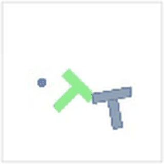
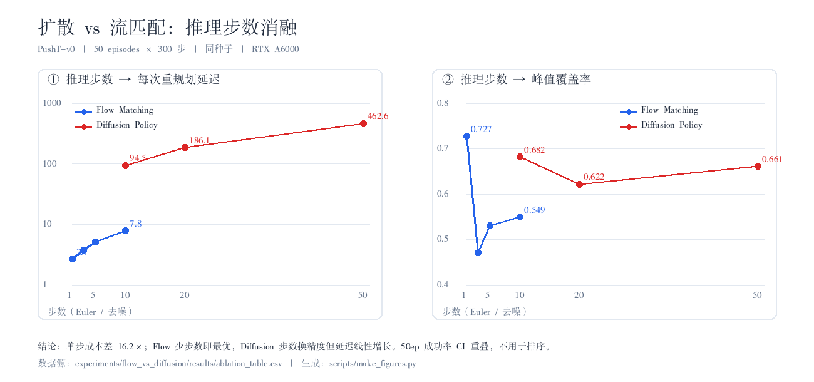
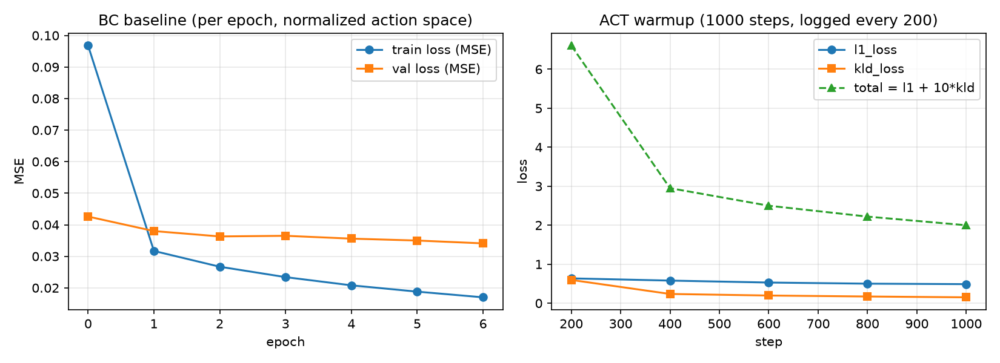

# PushT Policy Bench

    

模仿学习四条主流路线——**BC / ACT / Diffusion Policy / Flow Matching**——的可复现对比基准。当前覆盖
PushT 平面推块任务与 MetaWorld 单臂推球，对 LeRobot 生态中的策略给出统一环境下的
成功率、奖励、推理耗时与显存占用，并附完整消融与失效模式分析。

**算法一句话**：BC 把模仿当监督学习直接回归动作（下限基线）；ACT 加动作分块 +
CVAE（质量/延迟均衡解）；Diffusion Policy 用迭代去噪生成动作块（质量上限，推理成本
随采样步数线性增长，需 DDIM 裁剪）；Flow Matching 直接回归直线路径的速度场（少步数、
确定性、训练更稳，见 [定向对比实验](docs/flow_vs_diffusion.md)）。



*`lerobot/diffusion_pusht` 在 PushT-v0 上的评测回放：将 T 形蓝块推入目标区域，覆盖率达标即判定成功。*

## 任务介绍：PushT 是什么

PushT 是视觉运动模仿学习最常用的基准任务之一：用圆形夹爪把随机放置的 **T 形蓝色块**推进虚线标出的**绿色目标轮廓**，重叠覆盖率（coverage）达标即成功。状态空间为夹爪二维位置（`observation.state`，2 维），动作空间为夹爪下一步的二维目标位置（`action`，2 维），第三人称俯视相机提供 96×96 RGB 图像，控制频率 10 Hz。官方演示数据 206 条轨迹、25650 帧（本仓库使用本地 v3.0 格式副本）。单episode最长 5 秒（50 步），对误差累积敏感，适合暴露行为克隆的分布偏移问题。

## 结果

| 策略 | 任务 | Episodes | 成功率 | avg sum_reward | avg max_reward | 平均耗时 |
|---|---|---|---|---|---|---|
| `lerobot/diffusion_pusht`（官方权重） | PushT-v0 | 10 | **90.0%** | 71.91 | 0.963 | 5.08 s/ep |
| `bc_v2`（自训，ResNet18+增广，19k 步） | PushT-v0 | **50** | **10.0%** | 95.24 | 0.542 | ≈0.3 s/ep |
| `act_v2`（自训 30k 步） | PushT-v0 | **50** | **8.0%** | 61.09 | 0.594 | 1.49 s/ep |
| `act_v3`（自训 50k 步） | PushT-v0 | **50** | **14.0%** | 61.67 | 0.613 | 1.49 s/ep |
| `act_chunk10`（消融：chunk=10） | PushT-v0 | **50** | **18.0%** | — | 0.631 | 1.49 s/ep |
| `act_chunk1`（消融：单步） | PushT-v0 | **50** | 0.0% | — | 0.083 | 1.49 s/ep |
| `act_novae`（消融：关 CVAE） | PushT-v0 | **50** | 6.0% | — | 0.680 | 1.49 s/ep |
| `bc_baseline` v1（自训最小 BC） | PushT-v0 | 20 | 0.0% | 34.54 | 0.132 | ≈0.3 s/ep |
| `diffusion_baseline`（自训 7.7k 步，公平对照） | PushT-v0 | **50** | **6.0%** | 79.55 | 0.670 | ≈1.6 s/ep |
| `flow_baseline`（自训流匹配，7.7k 步公平对照） | PushT-v0 | **50** | 2.0% | 65.30 | 0.534 | ≈1.0 s/ep |
| `act_pusht_baseline` v1（自训 7680 步） | PushT-v0 | 20 | 0.0% | 43.62 | 0.471 | 1.27 s/ep |

自训基线详情（协议、曲线、失败归因）：[experiments/bc_baseline/](experiments/bc_baseline/)（v1 + v2）、[experiments/act_baseline/](experiments/act_baseline/)（v1）、[experiments/act_v2/](experiments/act_v2/)（v2）。
两个 v2 模型均获得非零成功率；扩到 50 episode 复测后 BC 10%（5/50）、ACT v2 8%（4/50）；ACT 继续加训至 50k 步（v3）后达 14%（7/50）反超 BC。三次实验一致表明：eval_loss 进入平台后成功率仍在随训练量上升。消融实验（同协议 50k 步）：chunk=1 成功率归零（动作分块的因果证据），chunk=10 最优 18%，关闭 CVAE 腰斩至 6%。四种失效模式对比：单步决策死于抖动、无 latent 死于分叉、完整 ACT 死于最后 5%、BC 死于累积。关键路径：BC v1 → v2 靠 ResNet18 + 增广（覆盖率 0.13→0.60）；ACT v1 → v2 靠步数进收敛区间（0.47→0.62）。
严格同协议对照（7680 步）：Diffusion 6%（3/50）> ACT 0% ≈ BC 0%，同预算下迭代去噪的动作块质量最高，但最先过拟合（epoch 6 后 eval_loss 回升）；代价是推理成本约为 ACT 的 170 倍（微基准），详见 [diffusion_baseline](experiments/diffusion_baseline/RESULTS.md)。

成功率 95% 置信区间 59.6%–98.2%（10 个 episode 样本量小，区间较宽，扩到 50 个 episode 会明显收窄）。

测试环境：NVIDIA RTX A6000 / driver 550.107.02 / CUDA 12.6 / PyTorch 2.7.1 / LeRobot 0.7.1 / Python 3.12。

失败样例见 [assets/demo_failure.mp4](assets/demo_failure.mp4)：该 episode 末帧覆盖率停在 0.63，夹爪在目标区边缘来回修正后超时。

## 第二阶段验收：环境搭建 / 复现 / 结果 / Demo

> 对照「3 算法 × 2+ MuJoCo 环境、≥5 组消融、README 四要素」三条标准的自检入口。
> 完整判定与算法 × 环境覆盖矩阵（数值由结果 JSON 自动生成）见
> [docs/phase2_acceptance.md](docs/phase2_acceptance.md)。
> **诚实结论**：第 2、3 条通过；第 1 条**部分达标** —— MuJoCo 环境有 2 个
> （MetaWorld push-v3、ALOHA），但这两个环境上目前只跑通 ACT 一个算法，
> BC / Diffusion / Flow 仅在 PushT（pymunk 引擎）上，详见报告第 3 节。

### 环境搭建

基础环境（PushT 评测与四算法基线）：

```bash
conda create -n lerobot python=3.12 -y && conda activate lerobot
git clone https://github.com/huggingface/lerobot.git && cd lerobot
pip install -e ".[training]"
pip install torch==2.7.1 torchvision==0.22.1 --index-url https://download.pytorch.org/whl/cu126
python -c "import torch; print(torch.__version__, torch.cuda.is_available())"
```

MuJoCo 类环境还需锚定依赖版本（否则会踩 `flex_bandwidth` / `eq_data` 两类结构体错配）：

| 环境 | 关键依赖 | 说明 |
|---|---|---|
| ALOHA `AlohaInsertion-v0` | `mujoco 3.8.1` + `dm-control 1.0.41` + `gym-aloha 0.1.5` | 三者约束交集唯一是 3.8.1，见 [act_aloha_transfer.md](docs/act_aloha_transfer.md) 第 6 节 |
| MetaWorld `push-v3` | `metaworld 3.0.0` + `mujoco` | 已在 3.8.1 下验证 reset/rollout 正常，见 [act_metaworld/RESULTS.md](experiments/act_metaworld/RESULTS.md) |

无显示器时统一开启离屏渲染（脚本已内置）：

```bash
export MUJOCO_GL=egl
export PYOPENGL_PLATFORM=egl
```

### 复现步骤

数据集缓存到 `<workspace-root>/datasets/`，训练/评估产物写到 `<workspace-root>/outputs/`；
用 `WZH_ROOT` 指向工作区即可（不设置时脚本默认取仓库上级目录）：

```bash
# 官方权重 PushT 评测（导出视频）
bash scripts/eval_pusht.sh

# ACT 迁移 ALOHA：训练 → 解析曲线 → 闭环评估 → 解析指标
WZH_ROOT=<workspace-root> bash experiments/act_aloha/scripts/run_train.sh
WZH_ROOT=<workspace-root> python experiments/act_aloha/scripts/parse_train_log.py
WZH_ROOT=<workspace-root> bash experiments/act_aloha/scripts/run_eval.sh
WZH_ROOT=<workspace-root> python experiments/act_aloha/scripts/parse_eval.py

# 生成 MetaWorld 训练曲线与第二阶段验收报告
python experiments/act_metaworld/scripts/plot_train_curves.py
python experiments/phase2_acceptance/scripts/build_acceptance.py

# ALOHA 数据集格式探查
WZH_ROOT=<workspace-root> python experiments/aloha_probe/scripts/probe_aloha.py
```

各基线、消融与失败分析的完整复现命令见对应 `experiments/*/RESULTS.md`
（[act_ablation](experiments/act_ablation/RESULTS.md)、
[diffusion_inference_steps](experiments/diffusion_inference_steps/RESULTS.md)、
[flow_vs_diffusion](experiments/flow_vs_diffusion/RESULTS.md)、
[failure_modes](experiments/failure_modes/RESULTS.md)）。

### 实验结果（跨环境）

| 环境 | 引擎 | 算法 | Episodes | 成功率 | 来源 |
|---|---|---|---:|---|---|
| PushT-v0 | pymunk | BC v2 / ACT v3 / Diffusion / Flow | 50 | 10% / 14% / 6% / 2% | [结果主表](#结果)、[flow_baseline](experiments/flow_baseline/RESULTS.md) |
| MetaWorld push-v3 | MuJoCo | ACT v1 / v2 | 20 | 0% / 0%（峰值奖励 0.513 / 0.477） | [act_metaworld](experiments/act_metaworld/RESULTS.md) |
| ALOHA AlohaInsertion-v0 | MuJoCo | ACT（2000 步） | 5 | 0%（Wilson CI 0–43.4%） | [eval_summary](experiments/act_aloha/results/eval_summary.md) |

> 跨环境成功率均为未收敛值，只用于证明链路可用，不作算法优劣排序；
> 训练曲线见 [assets/loss_curves.png](assets/loss_curves.png)、
> [assets/act_metaworld_train_curves.png](assets/act_metaworld_train_curves.png)、
> [assets/act_aloha_loss.png](assets/act_aloha_loss.png)。

### Demo 视频

按算法分类的完整回放清单见 [Demo 回放](#demo-回放按算法分类)。跨环境可直接播放的 mp4：

- ALOHA 双臂 rollout：[ep0（唯一非零奖励）](assets/act_aloha_eval_ep0.mp4)、[ep1（全零对照）](assets/act_aloha_eval_ep1.mp4)
- MetaWorld 过拟合失效：[metaworld_v2_best.mp4](assets/metaworld_v2_best.mp4)
- PushT 官方权重：[成功](assets/demo_success.mp4)、[失败](assets/demo_failure.mp4)
- Flow 1 步最佳轨迹：[flow_1step_best.mp4](assets/flow_1step_best.mp4)

## Flow Matching 板块：核心差异与机器人场景价值

> 一页讲清「流匹配和扩散到底差在哪、为什么机器人场景在意」。
> 源码级对照见 [docs/flow_notes.md](docs/flow_notes.md)，量化证据见
> [docs/flow_vs_diffusion.md](docs/flow_vs_diffusion.md) 与
> [experiments/flow_vs_diffusion/](experiments/flow_vs_diffusion/RESULTS.md)。

### 核心差异

| 维度 | Diffusion Policy（DDPM） | Flow Matching |
|---|---|---|
| 学什么 | 预测每一步加进去的噪声 ε（100 档离散步） | 预测噪声→动作的**直线路径速度场** v = x₁ − x₀（t∈[0,1] 连续） |
| 怎么生成 | N 步随机去噪（DDIM 可确定性跳步） | N 步 Euler 积分，**起点固定则结果确定** |
| 依赖什么 | beta schedule + 调度器 + 大 U-Net（251M） | 无调度表，一个速度场网络即可（最小实现 0.3M） |

一句话：扩散学「每步去掉一点噪声」，流匹配学「整条直线怎么走」——回归目标更直接，
低步数下更稳，也不需要噪声调度表。

### 机器人场景为什么在意（四条，均为本仓库实测）

1. **控制周期是硬约束**：PushT 10 Hz 约 100 ms 预算，ALOHA 50 Hz 只剩 **20 ms**。
   实测 Flow 1 步重规划 **2.67 ms**、Diffusion 10 步 **94.54 ms**（超预算 4.7 倍）——
   高频双臂闭环只有 Flow 1–3 步可用。[推理步数消融表](experiments/flow_vs_diffusion/results/ablation_table.md)
2. **步数不是越多越好**：直线插值下速度场理论为常数，实测 Flow **1 步反而最优**
   （峰值覆盖率 **0.727** vs 10 步 0.549），多步 Euler 反而累积中间时刻的拟合误差。
3. **确定性、可复现**：ODE 起点固定则动作确定，便于回归测试与安全部署；
   扩散每次采样不同（多模态是优点，也是不确定性来源）。
4. **训练更稳、参数与显存更省**：同协议 7680 步下训练 loss CV **0.147 vs 0.310**，
   速度场 0.3M 参数 / 462 MiB 显存 vs U-Net 251M / 4.98 GB。**但要诚实**：
   同预算成功率仍是 Diffusion **6%** > Flow **2%**，稳定不等于更强。
   [完整基线](experiments/flow_baseline/RESULTS.md)

### 边界：什么时候不该选 Flow

需要多模态动作多样性（多次采样选优）、且重规划预算 > 100 ms 时，Diffusion 10–20 步
或 DDIM-5 更合适；50ep 下各组成功率 Wilson 95% CI 全部重叠，**不能用成功率排序**。
按失效边界而非延迟选型的进一步讨论见
[docs/failure_mode_analysis.md](docs/failure_mode_analysis.md) 与
[docs/aloha_dataset_probe.md](docs/aloha_dataset_probe.md)。

## 核心维度定向对比：扩散 vs 流匹配

> 作品集重点：固定数据集、训练预算、评估协议，只对比「推理速度-步数关系」与「训练稳定性」两个核心维度，
> 另补动作平滑度分析。完整报告 [docs/flow_vs_diffusion.md](docs/flow_vs_diffusion.md)，
> 原始记录与可复现脚本 [experiments/flow_vs_diffusion/](experiments/flow_vs_diffusion/RESULTS.md)。



| 算法 / 步数 | 成功率 (50ep) | 峰值覆盖率 | sumR | 每次重规划 |
|---|---:|---:|---:|---:|
| **Flow 1** | **4.0%** | **0.727** | **92.6** | **2.67 ms** |
| Flow 10 | 0.0% | 0.549 | 71.9 | 7.76 ms |
| Diffusion 10 | 2.0% | 0.682 | 73.9 | 94.54 ms |
| Diffusion 50 | 6.0% | 0.661 | 79.9 | 462.63 ms |

**三个结论**：① 流匹配 1 步反而最优——直线插值下速度场理论为常数，多步 Euler 会累积中间时刻的拟合误差；
② 延迟严格线性（`Flow ≈ 2.13+0.567N` ms、`Diffusion ≈ 3.01+9.169N` ms），单步成本差 **16.2×**，
Flow 1 步比 Diffusion 10 步快 35.4×；③ 训练稳定性 Flow 更稳（CV 0.147 vs 0.310，劣化 1.42× vs 2.15×），
但既有基线质量更低——**稳定 ≠ 更强**。

**选型判据**：重规划预算 < 10 ms 只能 Flow；> 100 ms 且质量 / 多模态优先选 Diffusion 10–20 步。
50ep 下各组成功率 Wilson 95% CI 全部重叠，**不能用成功率排序**，应看峰值覆盖率、sumR 与延迟。

## 失效模式对比 + ALOHA 双臂数据集探查

> 从原理层面找两种算法的**失效边界**，并为下周双臂迁移做准备。
> 完整笔记：[失败模式分析](docs/failure_mode_analysis.md) ｜ [ALOHA 数据探查](docs/aloha_dataset_probe.md)；
> 抽帧图与 9 条回放见 [assets/](assets/)。

| 待检验说法 | 判定 |
|---|---|
| 扩散多步采样累积误差 | **不支持**（10→50 步配对符号检验 p=0.461） |
| 扩散 OOD 场景动作突变 | **部分支持**（42/50 初态四档全失败，但画面多为停滞而非突跳） |
| 流匹配单步精度普遍下降 | **不支持**（同初态 1 步 1.000 vs 10 步 0.147，另一个初态恰好反向） |
| 流匹配高速动态适配差 | **部分支持**（高速动作在精修阶段有害，在推进阶段有益） |
| **峰值达标后无法保持** | **强支持**：两条轨迹覆盖率到 1.000 后又被推走，终态最低掉到 0.183 |

**结论**：步数是与初态交互的旋钮，不是误差源；首要失效来自「动作块开环执行 + 示范数据没有保持监督」，
换算法救不了，要在数据/执行层加终止判断与闭环冻结。[逐帧量化表](experiments/failure_modes/results/failure_table.md)

**ALOHA 双臂探查**：`lerobot/aloha_sim_insertion_human` 加载成功，**50 集 / 25000 帧 / 50 fps**，
动作与状态同为 **14 维关节角**（左右臂各 6 关节 + 1 夹爪），观测**只有一路 top 相机**（480×640，非多视角），
任务为双臂插销入孔。50 Hz 控制把重规划预算压到 20 ms，只有 Flow 1–3 步可用；
插销任务又恰好要求「到位后保持」——正是上面那个主要失效模式。[迁移清单](docs/aloha_dataset_probe.md)

## 从零实现的 BC 基线

[baselines/bc/](baselines/bc/) 是一个约 200 行、端到端可运行的**单步行为克隆**基线（小 CNN 视觉编码器 + MLP 状态编码器 + 融合 trunk + 线性动作头），不依赖 lerobot 训练框架，便于逐行精读。ACT / Diffusion Policy 都共享这套"编码 + 融合"骨架，区别只在动作头。

**实验设置**：本地 pusht 数据集（198 条训练 / 8 条验证 episode）；图像 96×96；归一化（mean/std）后在归一化动作空间计算损失；batch_size 8（与 ACT demo 对齐）。

**结果对照**（batch_size=8，A6000，详细日志见 [experiments/](experiments/)）：

| | 参数量 | 峰值显存 | 损失函数 | 训练吞吐 |
|---|---|---|---|---|
| BC（本仓库） | 0.24M | **32 MiB** | MSE | 7680 步 / 188 s（≈41 步/s，batch=64） |
| ACT（lerobot 官方） | 51.6M | **≈950 MiB** | L1 + 10×KL（CVAE） | 1000 步 / 46 s（≈22 步/s，batch=8） |



*左：BC 前 7 个 epoch（机器负载高导致复跑中断，7 epoch 已呈收敛趋势；train 0.097→0.017，val 0.043→0.034，归一化动作空间 MSE）。右：ACT 预热 1000 步，loss 由 L1 回归项与 KL 散度项（`kl_weight=10`）相加而成，KLD 初期冲高后被压至 0.15 以下；BC 只有纯粹的回归损失。ACT 显存约为 BC 的 30 倍，来源是 ResNet18 视觉编码器、Transformer 结构以及默认 `chunk_size=100` 的动作序列标签。*

## 失败分析与改进方向

BC 在此任务上的已知缺陷与对应改进路线（完整推导见 [docs/theory.md](docs/theory.md)）：

1. **误差累积**：单步模仿误差 $\epsilon$ 在 T 步闭环中放大为 $O(T^2\epsilon)$（Ross et al. 2011）。失败样例中夹爪在目标区边缘来回修正即此表现 → 动作分块（ACT）、在线纠偏（DAgger）。
2. **多模态动作模糊**：MSE 回归在多种合理动作间取平均，输出"糊糊的动作" → CVAE latent（ACT）、扩散生成（Diffusion Policy）。
3. **训练/部署分布偏移**：部署时策略看到自己造成的画面，落在训练分布外 → DAgger 聚合标注、数据覆盖度增强。

4. **离线 loss 与在线成功率脱钩**（ACT 基线实测）：自训 ACT 在留出集 L1 上从 0.423 降到 0.375（epoch 12 后平台期），但 20 episode 在线评估成功率为 0——回归误差的微小改善不改变闭环行为的分叉点。评估策略必须看环境回滚，不能只看验证集 loss。

5. **归一化量纲错误在监督指标上是隐形的**（BC 基线实测）：v3.0 数据集图像是 `[0,1]` float 且 stats 同量纲，按旧版 0-255 约定二次除 255 后，训练/验证 loss 完全正常（train/test 同步缩放），但部署时正确预处理的输入与训练分布差 255 倍，rollout 覆盖率掉到 0.008。修复后重训，覆盖率恢复到 0.13，但 0.24M 小 CNN + 单步动作的 BC 仍 0/20——工程 bug 修掉后，算法瓶颈（容量、误差累积）才暴露出来。详见 [experiments/bc_baseline/RESULTS.md](experiments/bc_baseline/RESULTS.md)。

## Demo 回放（按算法分类）

**BC**
- [bc_v2_best.gif](assets/bc_v2_best.gif)：自训 BC v2（ResNet18+增广）成功推入
- [bc_v1_failure.gif](assets/bc_v1_failure.gif)：典型失效——分布外跑偏，夹爪停角落

**ACT**
- [act_v3_success.gif](assets/act_v3_success.gif)：自训 ACT 50k 步成功推入
- [act_v2_success.gif](assets/act_v2_success.gif)：ACT 30k 步成功
- [ablation_chunk1_best_effort.gif](assets/ablation_chunk1_best_effort.gif)：chunk=1 失效——停在 0.932 未过线
- [ablation_novae_best_effort.gif](assets/ablation_novae_best_effort.gif)：无 CVAE 失效——分叉选错，块反复进出

**Diffusion Policy**
- [diffusion_baseline_success.gif](assets/diffusion_baseline_success.gif)：自训基线成功（同协议 7.7k 步）
- [diffusion_nearmiss.gif](assets/diffusion_nearmiss.gif)：典型失效——覆盖率 0.9995 到位后保不住
- [demo_success.gif](assets/demo_success.gif)：官方权重 90% 成功率参考
- [demo_failure.mp4](assets/demo_failure.mp4)：官方权重失败样例

**Flow Matching**
- [flow_1step_best.gif](assets/flow_1step_best.gif)：1 步 Euler 最佳轨迹（峰值覆盖率 0.727）
- [flow_vs_diffusion_smoothness.jpg](assets/flow_vs_diffusion_smoothness.jpg)：与 Diffusion 的抽帧平滑度对比

**跨环境迁移（MetaWorld push-v3）**
- [metaworld_v2_best.gif](assets/metaworld_v2_best.gif)：ACT 迁移——"悬停不接触"过拟合失效

## 技术报告
- [ACT 跨本体迁移到 ALOHA 双臂插入](docs/act_aloha_transfer.md)
- 第二阶段验收对照（算法 × 环境覆盖矩阵、消融清单、README 自检）：[docs/phase2_acceptance.md](docs/phase2_acceptance.md)
- Flow Matching 源码拆解与结构对照见 [docs/flow_notes.md](docs/flow_notes.md)

完整结论汇总（基线对比、消融量化、失效模式分析）见 [docs/REPORT.md](docs/REPORT.md)；
三算法全维度对比与失效模式深度分析见 [docs/comparison.md](docs/comparison.md)；
选型建议速查见 REPORT 第 8 节；常见问答见 [docs/faq.md](docs/faq.md)；
扩散 vs 流匹配核心维度定向对比（步数消融、训练稳定性、动作平滑度、选型判据）见
[docs/flow_vs_diffusion.md](docs/flow_vs_diffusion.md)；
失败模式逐帧对比与双臂迁移准备见 [docs/failure_mode_analysis.md](docs/failure_mode_analysis.md)、
[docs/aloha_dataset_probe.md](docs/aloha_dataset_probe.md)。

## 这个仓库解决什么

机器人策略工作里最耗时的不是训练，而是**让环境跑起来、让数字可信**。本项目聚焦三件事：

1. **环境可复现** —— 两种搭建路径的取舍边界，附可自检的环境核对清单（[docs/environment.md](docs/environment.md)）
2. **指标可复现** —— 固定 episode 数、固定策略版本、逐 episode 导出录像，任何数字都能复算（[docs/results.md](docs/results.md)）
3. **失败可归因** —— 收集 11 条真实故障，每条给出"现象 / 根因 / 解法"，而不只是"改了什么让它能跑"（[docs/findings.md](docs/findings.md)）

## 快速开始

```bash
# 1. 环境（源码模式，便于改配置与调试）
conda create -n lerobot python=3.12 -y && conda activate lerobot
git clone https://github.com/huggingface/lerobot.git && cd lerobot
pip install -e ".[training]"

# 2. 对齐 GPU 版本（wheel 自带的 CUDA runtime 需与驱动匹配）
pip install torch==2.7.1 torchvision==0.22.1 \
  --index-url https://download.pytorch.org/whl/cu126

# 3. 核对
python -c "import torch; print(torch.__version__, torch.cuda.is_available())"

# 4. 评测（自动下载策略与数据集，导出视频）
bash scripts/eval_pusht.sh
```

无显示器的环境需要离屏渲染，脚本已内置：

```bash
export MUJOCO_GL=egl
export PYOPENGL_PLATFORM=egl
```

## 目录结构

```
.
├── README.md
├── configs/
│   └── act_pusht.yaml      # ACT 训练配置，每个超参标注调参依据
├── baselines/
│   ├── bc/                   # 最小单步 BC 基线（代码 + 配置 + 说明）
│   └── flow/                 # 最小 Flow Matching 动作头实现（对照 Diffusion）
├── experiments/
│   ├── bc_baseline/          # BC 20 epoch 训练日志与复现脚本
│   ├── act_warmup/           # ACT 1000 步预热训练日志与复现脚本
│   ├── flow_vs_diffusion/    # 扩散 vs 流匹配定向对比：10 个脚本 + 全量结果 + RESULTS.md
│   ├── failure_modes/        # 失败轨迹逐帧分析：3+3 条回放 + 假设检验
│   └── aloha_probe/          # ALOHA 双臂数据格式探查与迁移清单
├── docs/
│   ├── environment.md        # 环境方案对比与环境自检
│   ├── results.md            # 评测方法、逐 episode 明细、耗时分解
│   ├── findings.md           # 概念辨析与故障归因库
│   ├── theory.md             # BC 缺陷的数学解释、DAgger、ACT 解读、BC vs 离线 RL
│   ├── REPORT.md             # 项目技术报告：原理、基线对比、消融与失效模式分析
│   ├── comparison.md         # 三算法全维度对比 + 失效模式深度分析（含回放）
│   ├── diffusion_notes.md    # Diffusion Policy 源码拆解（架构图/形状实测/超参调参方向）
│   ├── flow_notes.md         # Flow Policy（流匹配）与 Diffusion 的结构差异 + 实测
│   ├── flow_vs_diffusion.md  # 扩散 vs 流匹配定向对比（步数消融 / 稳定性 / 选型）
│   ├── failure_mode_analysis.md # 失败模式逐帧对比与失效边界
│   ├── aloha_dataset_probe.md # ALOHA 双臂数据格式与迁移清单
│   └── faq.md                # 高频问答（全部答案带实测数据）
├── scripts/
│   ├── eval_pusht.sh       # 评测流水线（含 GPU 预检）
│   └── train_pusht.sh      # 训练流水线（支持冒烟参数）
└── assets/                 # 回放录像与 GIF、对比图表、失败轨迹抽帧
```

## 关键发现

**1. ACT / Diffusion Policy 是模仿学习，不是强化学习**

这两类策略的损失函数是动作回归（L1 + KL 正则），`next.reward` 不参与梯度计算。它们缺少强化学习的三个要件：奖励参与优化、试错探索、自举估计。归类上属于"监督学习中的行为克隆"，与 RL 的交集仅在于解决的序贯决策问题相同。

**2. 训练与推理是两套流程**

训练时输入来自固定数据集、有标准答案、可完全并行；推理时输入来自环境实时渲染、无答案、必须串行闭环。策略一旦偏离演示分布，看到的画面就落在训练分布之外，误差会累积放大（covariate shift）。这是行为克隆区别于普通监督学习的核心难点。

**3. 权重迁移后要检查 `device` 字段**

旧版 checkpoint 转换为新版 processor 格式时，若转换发生在无 GPU 环境，会把 `"device": "cpu"` 写入 `config.json`。策略会尊重该字段，不会自动改，表现为装了 GPU 版 torch 仍是 CPU 速度——实测相差两个数量级。

## 路线图

| 阶段 | 内容 | 状态 |
|---|---|---|
| P0 | 最小 BC 基线从零实现，跑通训练 / 验证 / 推理闭环 | 完成 |
| P1 | 环境搭建、官方权重评测、训练链路验证 | 完成 |
| P2 | ACT 从零训练至收敛，记录 loss / 成功率曲线 | 完成（30k 步 5% 成功率） |
| P3 | ACT / Diffusion / VQ-BeT 横向对比（成功率 + 推理延迟） | 计划 |
| P4 | 超参消融：`chunk_size` / `n_action_steps` / `kl_weight` / 学习率 | 部分完成（chunk_size、CVAE 见 [experiments/act_ablation/](experiments/act_ablation/)） |

## ACT 跨本体迁移到 ALOHA 双臂插入（快速训练）

把 ACT 从 PushT（单臂 2 维）迁移到 `lerobot/aloha_sim_insertion_human`（双臂 14 维），
2000 步快速训练跑通，loss 前 900 步 10.73→2.07（-80.7%）；闭环仿真评估也已跑通
（5 集、0 成功，未收敛——只证明链路可用，不作策略能力评价）。原先阻塞评估的
mujoco/dm_control 版本冲突已定位并修复（降级 mujoco 到 3.8.1），版本矩阵见报告第 6 节。

- 完整报告：[docs/act_aloha_transfer.md](docs/act_aloha_transfer.md)
- 单实验记录与脚本：[experiments/act_aloha/](experiments/act_aloha/RESULTS.md)
- 训练损失曲线：[assets/act_aloha_loss.png](assets/act_aloha_loss.png)
- 前序双臂数据探查：[docs/aloha_dataset_probe.md](docs/aloha_dataset_probe.md)
- 闭环评估摘要与 rollout 视频：[eval_summary.md](experiments/act_aloha/results/eval_summary.md)、[ep0](assets/act_aloha_eval_ep0.mp4)、[ep1](assets/act_aloha_eval_ep1.mp4)

## 跨环境迁移实验（MetaWorld push-v3）

SO-101 仿真已退出 lerobot 生态（无环境注册/无 extra/官方数据集下架），改用同为
MuJoCo 底层的 MetaWorld push-v3 验证 ACT 跨环境能力：同一套配方（chunk 30、lr 2e-5、CVAE）
零改动在新环境训出有目的行为的策略（v1 3000 步峰值奖励 0.51，冒烟出现成功 episode；
v2 20000 步过拟合出"悬停不接触"）。环境修复手册（mujoco 3.1.6 版本锚定、免 root EGL
libglvnd 方案、孪生环境补 39 维 keypoints、CUDA/EGL 初始化顺序）见
[experiments/act_metaworld/RESULTS.md](experiments/act_metaworld/RESULTS.md)。

## 参考

- [HuggingFace LeRobot](https://github.com/huggingface/lerobot)
- [gym-pusht](https://github.com/huggingface/gym-pusht)
- Zhao et al., *Learning Fine-Grained Bimanual Manipulation with Low-Cost Hardware* (ACT, RSS 2023)
- Chi et al., *Diffusion Policy: Visuomotor Policy Learning via Action Diffusion* (RSS 2023)

## License

MIT，见 [LICENSE](LICENSE)。
