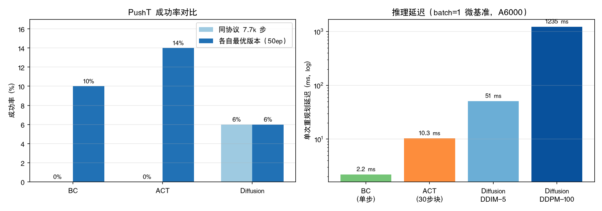

# PushT Policy Bench 技术报告

模仿学习三主流方案（BC / ACT / Diffusion Policy）在 PushT 任务上的可复现对比与消融研究。
所有实验数据、训练日志、逐 episode 评估结果与回放视频均在仓库内可复算；
本报告汇总核心结论，详细数据见各 `experiments/` 目录。

## 0. 背景：三类方案的设计动机与适用场景

行为克隆（BC）把模仿学习退化为监督学习：观测 → 直接回归动作。结构最简单、
推理最快，是任何模仿学习工作的下限基线；但单步决策在闭环中承受 $O(T^2\epsilon)$
的误差累积（Ross et al. 2011），且 MSE 回归在多模态演示下输出平均动作。

ACT 在 BC 骨架上做两件事：动作分块（一次预测 k 步，降低决策频率、块内平滑）+
CVAE 动作头（latent 建模多模态）+ 时间集成。推理一次前向，是质量与延迟的均衡解。

Diffusion Policy 把动作块生成交给迭代去噪：表达力最强、动作最平滑、多模态覆盖
最自然，代价是推理成本随采样步数线性增长，工程上必须做采样器裁剪（DDIM 低步数）。

选型直觉：**先跑 BC 建立下限；任务时域短、算力受限选 ACT；动作精度与多模态
要求高且有推理预算选 Diffusion。** 本仓库用统一协议量化验证了这条直觉。

## 1. 任务与评测协议

PushT：用圆形夹爪把 T 形块推入绿色目标轮廓，重叠覆盖率达标即成功。
观测为 96×96 第三人称图像 + 2 维夹爪位置，动作空间 2 维（10 Hz 控制）。
本地 pusht v3.0 数据集（206 episodes / 25650 帧），198 训练 / 8 验证划分。

统一评测协议：MuJoCo/gym-pusht 闭环回滚，最终报告采用 **50 episodes × 300 步**；
成功率之外同时记录峰值覆盖率与累计奖励。测试硬件 RTX A6000 / torch 2.7.1 / lerobot 0.7.1。

## 2. 基线：从零实现的单步 BC

[baselines/bc/](../baselines/bc/) 是一个约 200 行、不依赖训练框架的 BC 参考实现
（小 CNN 视觉编码器 + MLP 状态编码器 + 融合 trunk + 线性动作头，MSE 损失），
用于建立性能下限与逐组件精读对照。

| 版本 | 视觉骨干 | 增广 | 训练量 | 50ep 成功率 | 峰值覆盖率 |
|---|---|---|---|---|---|
| BC v1 | 小 CNN（0.24M） | 无 | 7.7k 步 | 0% | 0.13 |
| **BC v2** | **ResNet18（ImageNet）** | **随机平移（状态/动作联动）** | 19k 步 | **10%（5/50）** | 0.54 |

结论：单步 BC 的成功前提是输入侧——预训练骨干与位置不变性增广贡献了最大单项提升。

## 3. ACT 基线与训练量扩展

采用 lerobot 官方 ACT（ResNet18 + Transformer + CVAE，chunk 30 开环执行），
lr 2e-5，batch 64，与 BC 同数据同评测协议：

| 版本 | 训练量 | 50ep 成功率 | 峰值覆盖率 |
|---|---|---|---|
| ACT v1 | 7.7k 步 | 0%（20ep） | 0.47 |
| ACT v2 | 30k 步 | 8%（4/50） | 0.59 |
| **ACT v3** | **50k 步** | **14%（7/50）** | **0.61** |

完整训练后 ACT 反超 BC（14% vs 10%）。两者取胜路径不同：BC 靠输入侧改造，
ACT 靠优化量进入收敛区间。参考点：官方 diffusion 权重 90%（10 ep）。

## 3.5 Diffusion Policy 公平对照基线

与 BC v1 / ACT v1 完全同协议（7680 步、同数据划分、每 384 步评估、batch 64），
算法侧用官方 PushT 默认：n_obs_steps=2、horizon=16、n_action_steps=8、DDPM 100 步。

| 模型 | 成功率（50ep） | 峰值覆盖率 | 备注 |
|---|---|---|---|
| BC v1 | 0% | 0.13 | 小 CNN |
| ACT v1 | 0% | 0.47 | 欠训练 |
| **Diffusion** | **6%（3/50）** | **0.67** | 同预算唯一非零；epoch 6 后过拟合，评估用 step 3840 checkpoint |

结论：同预算下 Diffusion 动作块质量最高（迭代去噪天然平滑），但 251M 参数 U-Net
在小数据上最早撞过拟合墙；推理成本比 ACT 高约 170 倍（batch=1 微基准）。详见
[diffusion_baseline](../experiments/diffusion_baseline/RESULTS.md)。

三算法工程指标对比（微基准 batch=1，A6000）：

| | BC v2 | ACT v3 | Diffusion |
|---|---|---|---|
| 参数量 | 11.2M | 51.6M | 262.7M |
| 训练峰值显存 | 0.03 GB | 1.44 GB | 4.98 GB |
| 单次重规划耗时 | 2.2 ms（单步） | 10.3 ms（30 步块） | ≈1700–2200 ms（32 步块，100 步 DDPM） |
| 摊到单步动作 | 2.2 ms | 0.34 ms | ≈55 ms |

## 4. 消融研究

统一 50k 步训练、50 episodes 评估，每组只改一个变量：

| 消融 | 变量 | 成功率 | 结论 |
|---|---|---|---|
| 动作分块 | chunk 1 / 10 / 30 | **0% / 18% / 14%** | 分块是误差累积抑制的因果机制；甜点在 10 附近，过长块重新累积开环误差 |
| CVAE | use_vae on / off | **14% / 6%** | latent 的价值在减少灾难性分叉而非提升平均精度（关 VAE 峰值覆盖率反升 0.68） |

横向发现（三次独立复现）：eval_loss 进入平台期后成功率仍随训练量/输入侧改造显著变化——
**离线回归损失不能替代闭环评估**。

### 推理采样步数消融（Diffusion）

同一 checkpoint 只改推理采样器（零重训，50ep 同种子）：

| 采样器 | 成功率 | 峰值覆盖率 | 单次重规划 |
|---|---|---|---|
| DDIM 5 步 | 6%（3/50） | 0.599 | **51 ms** |
| DDIM 20 步 | 4%（2/50） | 0.622 | 270 ms |
| DDPM 100 步（默认） | 6%（3/50） | 0.670 | 1235 ms |

5 步 DDIM 以 1/24 的推理成本追平默认配置的成功率，覆盖率仅让 11%——
精度-速度权衡在低步数段非常平坦。详见
[diffusion_inference_steps](../experiments/diffusion_inference_steps/RESULTS.md)。

## 5. 失效模式分析

| 策略 | 致命环节 | 典型表现 |
|---|---|---|
| BC | 单步误差累积（$O(T^2\epsilon)$） | 绕块空转、越推越偏；多模态下动作发"糊" |
| ACT（chunk=1） | 退化为单步决策 | 偶发推得很好（0.932），多数 episode 夹爪抖动——方差极大 |
| ACT（无 CVAE） | 分叉决策 | 推得准但选错绕行侧，块在目标边缘反复进出 |
| ACT（完整） | 最后 5% 覆盖 | 块到位但插不准，修正超时 |
| 小数据 + 大训练量 | 过拟合安全行为 | MetaWorld 迁移实验中表现为"悬停不接触" |

一句话：**BC 死于累积，ACT 死于分叉**；chunk=1 消融把 ACT 打回 BC 的失效模式，属因果互证。

## 6. 跨环境迁移验证

ACT 配方零改动迁移至 MetaWorld push-v3（MuJoCo 单臂，80 Hz，480×480）：
训出有目的推球行为（v1 3000 步峰值奖励 0.51）。环境适配的完整记录
（mujoco 版本锚定、免 root EGL 渲染、39 维环境状态补齐）见
[act_metaworld](../experiments/act_metaworld/RESULTS.md)。

## 7. 已知边界

- 自训 ACT（14%）与官方 diffusion（90%）差距主要在训练预算与推理配置（时间集成未开）；
- 消融与基线对比基于 50 episodes，10% vs 14% 未严格统计分离；
- MetaWorld 侧受 100-episode 小数据限制，增广与数据规模是下一步瓶颈。

## 实验索引

| 目录 | 内容 |
|---|---|
| [baselines/bc](../baselines/bc/) | 单步 BC 参考实现（v1/v2 配置 + 在线评估脚本） |
| [experiments/bc_baseline](../experiments/bc_baseline/) | BC v1/v2 训练日志与评估明细 |
| [experiments/act_baseline](../experiments/act_baseline/) / [act_v2](../experiments/act_v2/) / [act_v3](../experiments/act_v3/) | ACT 基线三个训练量级 |
| [experiments/act_ablation](../experiments/act_ablation/) | chunk_size 与 CVAE 消融 |
| [experiments/act_metaworld](../experiments/act_metaworld/) | 跨环境迁移（MetaWorld push-v3） |
| [docs/theory.md](theory.md) | 分布偏移的数学解释、DAgger、BC vs 离线 RL |
| [docs/findings.md](findings.md) | 环境/工程故障归因库 |

## 8. 选型建议（基于本仓库实测数据）

| 场景 | 推荐 | 依据 |
|---|---|---|
| 快速验证数据/环境管线 | BC（小 CNN 即可） | 32 MiB 显存、9s/epoch，任何 bug 都能分钟级暴露 |
| 算力受限、实时控制（≥10Hz） | ACT | 10ms/块，14% 成功率，chunk 10 甜点 |
| 小数据集（百级 episodes） | ACT + 增广 | Diffusion 的 251M U-Net 最先过拟合（epoch 6） |
| 动作精度要求高（精密装配/贴合） | Diffusion + DDIM 5–20 | 迭代去噪的动作精度上限最高 |
| 演示存在多种合理动作（多模态） | Diffusion > ACT | 采样覆盖多模态 > CVAE latent > MSE 平均 |
| 跨环境快速迁移 | ACT（已验证） | 配方零改动从 PushT 迁到 MetaWorld |

## 9. 汇总图

