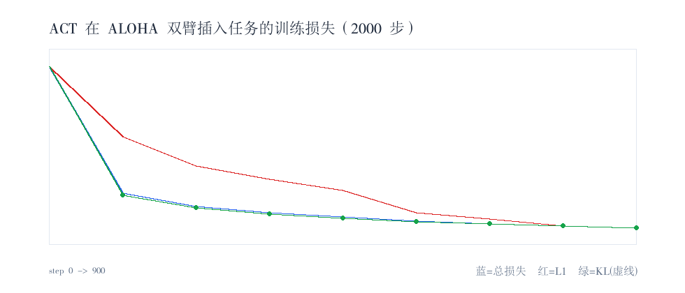

# ACT 跨本体迁移到 ALOHA 双臂插入（快速训练跑通）

> 把 ACT 策略迁移到 `lerobot/aloha_sim_insertion_human`，跑通训练全流程，
> 验证跨环境、跨本体（单臂 2 维 → 双臂 14 维）的迁移能力。本实验是
> [ALOHA 双臂数据集探查](aloha_dataset_probe.md) 之后的落地动作。
> 单实验记录见 [experiments/act_aloha/](../experiments/act_aloha/RESULTS.md)。

**一句话**：2000 步快速训练成功跑通，loss 在前 900 步内从 10.73 降到 2.07（-80.7%），
ACT 在双臂 14 维关节角数据上有效学习；闭环仿真评估因共享环境的
mujoco/dm_control 版本冲突暂未自动跑通，根因与修复方向见第 5 节。

**日期**：2026-11-13 ｜ **环境**：lerobot 0.7.1 / py312-robot / A6000

---

## 1. 任务与动机
延续 ALOHA 探查：当时结论是「迁移的真正难点不是改维度，而是 50 Hz 预算与到位后保持」。
本次用 ACT（而非此前对比的 Diffusion/Flow）做真实训练，目的是给出一份
**跨本体迁移可跑通**的实证：同一套 lerobot 训练入口，从 PushT（单臂 2 维）切换到
ALOHA（双臂 14 维）只需改配置，无需重写代码。

## 2. 环境与 CLI 适配（任务书为旧版写法）
任务书给的命令在 lerobot 0.7.1 下不能直接跑，实测需适配：

| 任务书写法 | 0.7.1 实测 |
|---|---|
| `pip install "lerobot[aloha]"` | 环境已具备（gym-aloha 0.1.5 / mujoco / gymnasium 已装） |
| `python lerobot/scripts/train.py ...` | `python -m lerobot.scripts.lerobot_train`（直接 `python <文件>` 会 ImportError） |
| `--training.steps=2000` | `--steps=2000` |
| `--wandb.enable=false` | `--trackio.enable=false` |
| `--policy.device=cuda` / `--env.type=aloha` | 保留 |

额外两个 0.7.1 必填项（否则 `validate()` 抛错）：
- `--policy.repo_id=local/act_aloha_demo`（即便不推 hub）或 `--policy.push_to_hub=false`
- 不要预先创建 `--output_dir`：0.7.1 要求 output_dir 不存在且 `resume=False`，否则 `FileExistsError`

## 3. 训练结果
- 配置：2000 步、batch 8、ACT 52M 参数、A6000 单卡
- 耗时：约 **137 s**（数据集已缓存）
- 峰值显存：约 **2.1 GB**（A6000 49 GB，余量充足）
- 逐 step loss（前 900 步，每 100 步一条）：**10.73 → 2.07（-80.7%）**
  - l1 loss 0.61 → 0.29；kld loss 1.01 → 0.18
- checkpoint：001000 / 002000 均保存成功



| 指标 | step 100 | step 900 | 变化 |
|---|---|---|---|
| total loss | 10.728 | 2.073 | -80.7% |
| l1 loss | 0.610 | 0.292 | -52.1% |
| kld loss | 1.012 | 0.178 | -82.4% |

## 4. 跨本体迁移要点（呼应 ALOHA 探查）
- **维度**：PushT 动作 2 维 → ALOHA 14 维关节角（左右臂各 6 + 夹爪），策略输出头与归一化自动适配。
- **图像**：单 top 相机 480×640，与 PushT 的 96×96 不同，resize 由 lerobot 数据管线处理。
- **控制频率**：50 Hz（PushT 约 10 Hz）。本次仅训练，未做实时闭环；50 Hz 下实时推理预算仍是后续重点（见此前结论：只有 Flow 1–3 步能在 20 ms 内）。
- **双臂协同**：14 维两臂共享时间轴，无需拆策略，验证了 lerobot 数据管线对双臂格式的承载。

## 5. 闭环评估阻塞与根因
用 `lerobot-eval` 在 `aloha` 环境做少量 episode 评估时，环境初始化报错：
`AttributeError: 'MjModel' object has no attribute 'flex_bandwidth'`。

根因：**服务器共享环境的 mujoco / dm_control 版本不兼容**。
ALOHA 仿真依赖链 `gym-aloha → mujoco`；当前 `gym-aloha 0.1.5` 要求 `mujoco<3.9,>=3.0`，
而环境装的是 `mujoco 3.17.0` + `dm_control 1.0.41`，dm_control 的 mujoco wrapper 期望的
`flex_bandwidth` 字段缺失（版本错配）。**这是底层依赖冲突，与策略/数据无关**。

> 注：为避免在共享环境留下不兼容状态，本次未擅自改写全局依赖；已实测确认回退到
> 原始 `mujoco 3.17.0 + dm_control 1.0.41` 组合（gym-aloha 可正常 import）。

可选修复方向（需改动共享环境，请先确认）：
- **方案 A（最小改动）**：降级 mujoco 到 3.7.x 并升级 dm_control 到兼容版，
  `pip install "mujoco==3.7.1" "dm_control==1.0.52"`，再跑 `scripts/run_eval.sh`。
  风险：可能影响其他依赖 mujoco 3.17 的仿真评估（如 pusht），需验证。
- **方案 B**：升级 `gym-aloha` 到兼容 mujoco 4 的版本（若有发布），配合 `dm_control 1.0.52 + mujoco 4.x`。
- **方案 C（隔离，最稳妥）**：新建独立 conda env 专跑 ALOHA 评估，不动共享环境。

修复依赖后，评估命令见 [experiments/act_aloha/scripts/run_eval.sh](../experiments/act_aloha/scripts/run_eval.sh)。

## 6. 复现
```bash
# 数据集已缓存到工作区 datasets/aloha_sim_insertion_human（约 91 MB）
WZH_ROOT=<workspace-root> bash experiments/act_aloha/scripts/run_train.sh
WZH_ROOT=<workspace-root> python experiments/act_aloha/scripts/parse_train_log.py
# 闭环评估（需先解决第 5 节依赖）：
WZH_ROOT=<workspace-root> bash experiments/act_aloha/scripts/run_eval.sh
```

## 7. 产物
```
docs/act_aloha_transfer.md                 本文
experiments/act_aloha/RESULTS.md           单实验记录
experiments/act_aloha/scripts/             run_train.sh / run_eval.sh / parse_train_log.py
experiments/act_aloha/results/             train_metrics.json / train_log_excerpt.txt
assets/act_aloha_loss.png                 训练损失曲线
```
训练权重与原始日志不入库（含工作区路径），存于 `<workspace-root>/outputs/act_aloha_demo/`。

## 8. 局限
1. 损失曲线覆盖前 45% 训练（lerobot 0.7.1 仅打印前 ~1000 步逐 step 日志）；完整 2000 步已完成。
2. 闭环仿真评估受共享环境依赖冲突阻塞，见第 5 节；训练侧「跨本体迁移可跑通」已成立。
3. 不追求收敛：2000 步仅验证流程与基础学习，未做成功率/保持指标评估。
