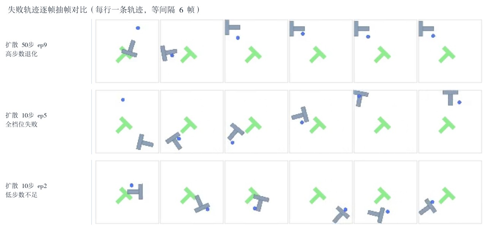
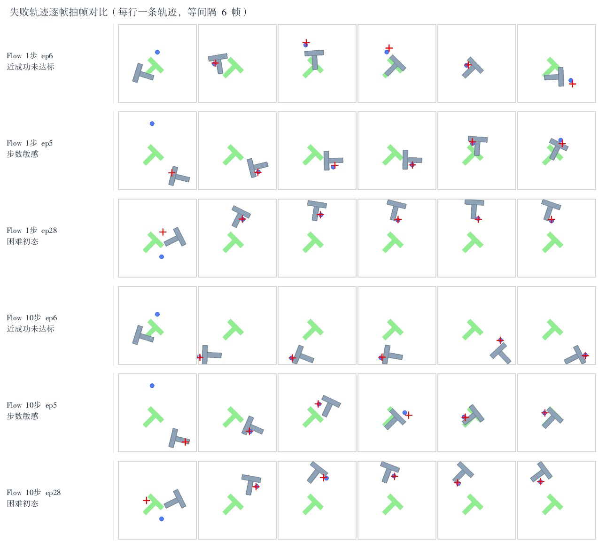

# 扩散 vs 流匹配：失效模式对比分析

> 从原理层面理解两种算法的**失效边界**。本文不预设结论：对常见说法逐条做假设检验，
> 用 50ep 同种子配对统计 + 3+3 条失败轨迹逐帧分析来判定「支持 / 不支持 / 部分支持」。
> 量化对比表见 [failure_table.md](../experiments/failure_modes/results/failure_table.md)，
> 原始记录与脚本见 [experiments/failure_modes/](../experiments/failure_modes/RESULTS.md)；
> 步数消融与选型基线见 [flow_vs_diffusion.md](flow_vs_diffusion.md)。





**一句话结论**：真正的首要失效既不是「扩散多步累积误差」，也不是「流匹配单步精度下降」，
而是**峰值达标后无法保持**——两条 Flow 轨迹曾把 T 块完全推到目标（覆盖率 1.000），随后继续开环推动又把它推走。
步数不是误差源，而是与初始状态交互的旋钮；**42/50 个初态在扩散四个步数档全部失败**，
说明大多数失败由初态难度和示范数据覆盖决定，换算法或调步数都救不了。

**日期**：2026-11-13 ｜ **环境**：RTX A6000 / `py312-robot` / torch 2.7.1+cu126 ｜ **任务**：PushT-v0

---

## 0. 实验设计

| 项目 | 设置 |
|---|---|
| Diffusion 证据 | 既有 5/10/20/50 步四档评估，**同 50 个种子**，共 200 组结果配对；每档前 10 条存有回放视频 |
| Flow 证据 | 既有 1/3/5/10 步四档消融；另按完全相同的 seed 与开环协议**重录 3 个初态 × 2 档（1 / 10 步）**，共 6 条 300 帧视频与逐帧动作/奖励 |
| 失败轨迹选取 | 扩散 3 条（高步数退化 / 全档位失败 / 低步数不足）；流匹配 3 条（近成功未达标 / 步数敏感 / 困难初态），每条配同种子另一档作对照 |
| 逐帧口径 | 灰度帧差 → 运动能量；二阶差分 → jerk 代理；按实际动作块长度切分比较块边界与块内；动态阈值定义停滞帧 |
| 统计口径 | 配对符号检验（忽略 0.02 以内平局，双侧二项 p 值），避免用 50ep 的成功率排序 |

> 「下载轨迹」在本仓库内的落地形式：9 条 mp4 已复制进 `assets/`，可直接播放；
> 完整 300 帧逐帧序列在 `results/*_analysis.json` 的 `per_frame` 字段。

---

## 1. 假设检验总表

| 编号 | 待检验说法 | 判定 | 关键证据 |
|---|---|---|---|
| H1 | 扩散多步采样累积误差：步数越多同初态越差 | **不支持** | 10→50 步平均 Δ=−0.0217，改善 20 / 退化 26，符号检验 p=0.461；20→50 p=1.0；四档平均覆盖率 0.599 / 0.683 / 0.622 / 0.661 非单调 |
| H2 | 极端分布外场景导致动作突变 | **部分支持** | 42/50 初态四档全失败、仅 8 个初态曾成功 → 初态主导成立；但失败轨迹尖峰率 0.18–0.25，画面更多是「贴块微调后停滞」而非突跳 |
| H3 | 流匹配单步推理细节精度普遍下降 | **不支持** | 同初态 ep6：1 步 1.000 vs 10 步 0.147；ep5 反向：1 步 0.380 vs 10 步 1.000。方向不一致，是**步数 × 初态交互** |
| H4 | 流匹配高速动态场景适配性不足 | **部分支持** | 接近目标的高速段 Δreward 为负（−0.00082 / −0.00463），推进阶段高速段为正（+0.00469）。不是「高速整体不行」，而是**精细调整阶段的大幅动作有害** |
| H5 | 新增：峰值达标后无法保持，是本次可直接证实的主要失效 | **强支持** | 1 步 ep6 第 203 步覆盖 1.000 → 终态 0.183（衰减 0.817）；10 步 ep5 峰值 1.000、终态 0.920 仍判失败 |
| H6 | 困难初态无法靠换采样步数稳定救援 | **支持** | ep28：Flow 1/10 步恒为 0；Diffusion 四档在 0 / 0.568 / 0 / 0.968 间剧烈跳变（极差 0.968）且无一成功 |

完整证据串与自动生成的数值见 [failure_summary.json](../experiments/failure_modes/results/failure_summary.json)。

---

## 2. 三条扩散失败轨迹

| 档位 / ep | 峰值覆盖 | 停滞比 | 块边界 jerk 比 | 逐帧判读 | 归因 |
|---|---:|---:|---:|---|---|
| 50 步 ep9 | 0.475 | 0.10 | **3.20** | 夹爪接触后把块推离目标并停在左上；后半程运动能量从 0.00297 掉到 0.00136 | 高步数下块边界不连续最重，后期陷入「推一下就停」 |
| 10 步 ep5 | 0.000 | 0.28 | 1.42 | 灰块被推到画面边缘，与绿色目标全程分离，夹爪贴块反复微调 | 困难初态 / 接触构型不利，四档皆 0 |
| 10 步 ep2 | 0.436 | **0.31** | 2.57 | 灰块绕目标下方来回打转，多帧姿态往复 | 低步数下动作块方向不稳，缺少收敛到目标的修正 |

**要点**：三条都出现长时间停滞（停滞比 0.10–0.31），且块边界 jerk 比全部 >1。
扩散的失效不是「步数太多把噪声累积起来」，而是**每个动作块执行完才重新规划，块内没有反馈**；
块边界 jerk 比在 1.42–3.20 之间；同为 10 步档的两条轨迹就有 1.42 与 2.57 的差距，说明差异主要来自初态与轨迹，而非步数单调作用。

### 为什么「多步累积误差」在扩散里不成立

DDPM 的每一步都以**当前** `x_t` 为条件重新预测噪声 `eps_theta(x_t, t)`，是重条件化的迭代精修，
不是把同一次预测开环积分到底；训练目标本身就是任意 $t$ 下去噪，中间偏差会在下一步被重新观测与修正。
实测四档配对无显著退化、平均覆盖率非单调，正好对应这个机制。
**真正会沿积分链累积误差的是 Flow 的 Euler 开环积分**——这也解释了既有消融里「Flow 1 步最优、加到 10 步退化」。

---

## 3. 三条流匹配失败轨迹（含同种子 1 / 10 步对照）

| 初态 | 1 步峰值 | 10 步峰值 | 判读 |
|---|---:|---:|---|
| ep6（近成功未达标） | **1.000**（第 203 步，终态 0.183） | 0.147 | 1 步曾完全对齐，随后继续开环推动把块推走；换 10 步后几乎不动 |
| ep5（步数敏感） | 0.380 | **1.000**（第 273 步，终态 0.920） | 1 步只在目标右下游走；10 步到位且基本保持，但 `is_success` 仍为 False |
| ep28（困难初态） | 0.000 | 0.000 | 灰块全程停在目标反侧，夹爪贴块却带不动；两档都零覆盖 |

**要点**：同一初态换步数，覆盖率能从 0.147 跳到 1.000（ep6 反向亦成立）。
这说明「单步精度下降」不是普遍规律：直线插值下速度场 `v = x1 - x0` 理论上为常数，
单步 Euler 在「初态→目标」近似直线的场景里就是精确解；当初态需要弯曲路径时，
多步积分才有机会修正，但 0.3M 小网络在中间时刻的拟合误差又会沿积分链累积。
**两种效应谁占上风由初态决定**，因此消融里 1 步平均最优、个案上却可能最差。

**高速动态（H4）的更精确表述**：把 300 步按动作速度分位切成高/低速段，比较覆盖率**增量**
（而非累计 reward，后者会被时间趋势混淆）。推进阶段高速段 Δreward 为正（+0.00469），
接近目标阶段高速段为负（−0.00082 / −0.00463）。即**大幅动作适合搬运、不适合精修**，
这是动作幅度调度问题，不是算法对高速场景的整体不适配。

---

## 4. 从原理看共同的失效边界

### 4.1 首要失效：峰值达标后无法保持

两条轨迹覆盖率到过 1.000，最终却判失败。三者共同机制：

1. **动作块开环执行**：Flow K=8、Diffusion K=32，块内无观测反馈，推到目标后仍按既有动作继续推。
2. **示范数据里没有「保持」监督**：人类演示在推到位后停手，但回归/速度场/去噪目标学的是动作分布，
   没有显式的「到位 → 输出零动作」状态转移，也没有终止信号。
3. **奖励与判据错位**：PushT 每步 reward 是覆盖率，峰值可达 1.0，而 `is_success` 看终态，
   于是出现 `max_reward=1.0` 但 `success=False`。

这不是换算法能解决的；缓解要在**数据/执行层**：缩短动作块并提高重规划频率、加时间集成、
在示范里补「保持」片段或加终止头、用闭环反馈在覆盖率达标时冻结输出。

### 4.2 次要失效：块边界不连续

块边界 jerk 比 Diffusion 1.42–3.20、Flow 1.12–2.09，全部 >1。
两者都采用「开环执行整块 → 重规划」，边界是唯一可能不连续的位置；
Flow 因 K=8 重规划频率是 Diffusion 的 4 倍，边界数量更多。这与既有平滑度分析一致。

### 4.3 失败的主因在初态，不在步数

42/50 初态在扩散四档全部失败，同初态跨档位覆盖率的平均极差达 0.46 且方向随机；
Flow 侧 ep28 在两档也是恒 0。**成功率低主要是训练数据只覆盖 198 条轨迹、
初态分布覆盖不足**，加步数、换采样器都无法补齐数据边界。

---

## 5. 结合思考：什么场景优先选谁

| 场景 | 推荐 | 本次证据 |
|---|---|---|
| 控制周期紧（50 Hz 双臂、边缘部署） | **Flow 1 步** | 2.67 ms/次重规划；Diffusion 10 步 94.5 ms 已超 4 个控制周期 |
| 需要确定性、可复现、便于回归测试 | **Flow** | ODE 起点固定即确定；Diffusion 同初态跨档位覆盖率平均极差 0.46，采样随机 |
| 初态分布窄、示范充分、追求少步数收敛 | **Flow** | 直线路径假设成立时单步即精确解，训练 CV 0.147 也更稳 |
| 初态需要多模态试探、可多次采样选优 | **Diffusion** | 随机去噪天然给出不同轨迹；四档同初态结果差异大反而是采样多样性 |
| 离线规划、预算充足、追求动作精度上限 | **Diffusion 10–20 步** | 251M U-Net 表达力更强，既有基线峰值覆盖 0.670 vs Flow 0.534 |
| 需要「到位后保持」（插入、装配、夹持） | **都不是，先改数据与执行层** | Flow 两条轨迹峰值 1.0 后被推走，扩散侧表现为长时间停滞；同属开环动作块问题，需终止判断 / 闭环冻结 / 保持监督 |
| 初态分布很宽、OOD 多 | **先扩数据，再谈算法** | 42/50 初态四档全失败，换步数无效 |
| 高步数预算换质量但怕误差累积 | 用 Diffusion，不要给 Flow 加步数 | 扩散是重条件化迭代精修；Flow 是开环 Euler 积分，才会沿链累积误差 |

**与上次消融结论的关系**：上次给出「按控制周期选型」的工程判据；这次补充了
「按失效边界选型」——**先判断失败是初态覆盖不足、步数交互、还是保持行为缺失，
再决定调数据、调步数、还是调算法**，不要用成功率数字硬排顺序。

---

## 6. 复现

```bash
cd pusht-policy-bench/experiments/failure_modes
conda activate py312-robot
# 若 shell 未初始化 conda，先执行 eval "$(conda shell.bash hook)"
# 外部产物默认位于仓库上一级目录；换位置则 export WZH_ROOT=<workspace-root>

python3 scripts/analyze_diffusion_failures.py   # 四档配对统计 + 3 条扩散失败轨迹
python  scripts/record_flow_failures.py         # 3 初态 x 2 档录制（约 20 s）
python3 scripts/summarize_failures.py           # 对比表 + 假设检验结论
```

依赖：`cv2`、`Pillow`、`gym_pusht`、`torch`；外部数据为
`outputs/diffusion_eval_steps{5,10,20,50}/eval_info.json` 与对应回放视频、
`bc/outputs/flow/checkpoint.pt`，以及仓库内 `experiments/flow_vs_diffusion/results/` 的消融结果。
脚本按 `Path(__file__)` 相对定位仓库，不改动既有训练/评估代码。

---

## 7. 产物清单

```
docs/failure_mode_analysis.md                 本文
experiments/failure_modes/RESULTS.md          单实验记录
experiments/failure_modes/scripts/            4 个脚本（逐帧模块、扩散配对、Flow 录制、汇总）
experiments/failure_modes/results/            diffusion_failure_analysis.json / flow_failure_analysis.json
                                              flow_failure_actions.json（6 x 300 步动作与奖励）
                                              failure_table.md / failure_summary.json
assets/failure_diffusion_contact_sheet.jpg    扩散 3 条失败轨迹抽帧
assets/failure_flow_contact_sheet.jpg         流匹配 6 条轨迹抽帧
assets/failure_diffusion_*.mp4               3 条扩散失败回放
assets/failure_flow_1step_*.mp4              3 条流匹配失败回放
assets/control_flow_10step_*.mp4             3 条同种子 10 步对照回放
```

---

## 8. 局限

1. **样本量**：扩散视频只存档前 10 条 episode，代表性失败轨迹从这 10 条里挑；配对统计用满 50ep 弥补。
2. **像素代理指标**：jerk/停滞来自渲染帧差，不是真实关节量；Flow 侧另有 300 步真实动作序列，扩散侧只有视频。
3. **OOD 未直接量化**：没有导出训练集初态分布，用「四档一致失败」作初态难度的代理，未计算分布距离。
4. **保持失效未在扩散侧逐帧验证**：扩散只有 eval 汇总、无逐步奖励，H5 的强证据来自 Flow；是否与扩散同源还需补录扩散逐步奖励。
5. **录像复现随机性**：Flow 重录与消融评估同 seed 同协议，但环境渲染与浮点累加仍可能有微小差异。
