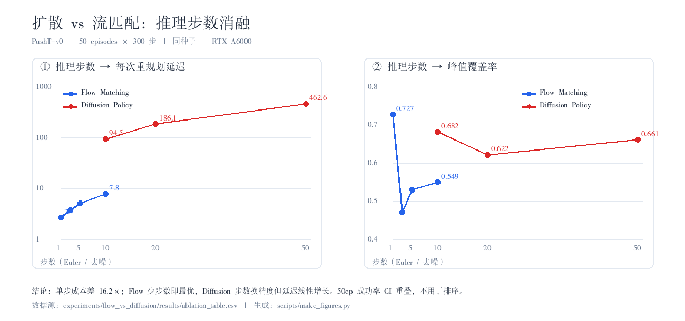
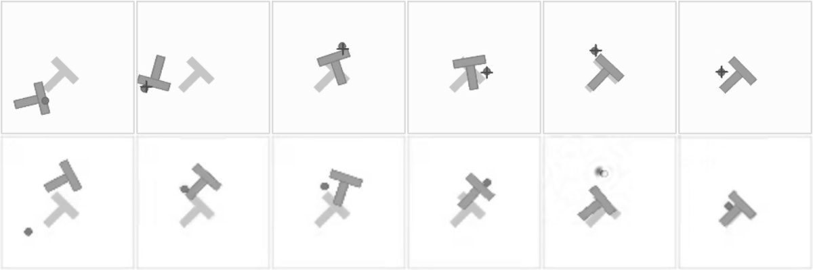

# 扩散 vs 流匹配：核心维度定向对比

> 本仓库的**技术深度主报告**。固定数据集、训练预算与评估协议，只对比两个核心维度：
> **① 推理速度与步数的关系 ② 训练稳定性**，并补动作平滑度分析。
> 原始实验记录与全部可复现脚本见 [experiments/flow_vs_diffusion/](../experiments/flow_vs_diffusion/RESULTS.md)；
> 三算法横向对比见 [comparison.md](comparison.md)，Flow 实现拆解见 [flow_notes.md](flow_notes.md)。



*左：延迟随步数严格线性（对数轴），单步成本相差 16.2×。右：Flow 1 步的峰值覆盖率 0.727 为全表最高，加步数反而退化。图由 `experiments/flow_vs_diffusion/scripts/make_figures.py` 从 `ablation_table.csv` 生成。*

**一句话结论**：流匹配把「单步成本」压到扩散的 1/16，1 步 Euler 即拿到本次实验最高的峰值覆盖率（0.727）与 2.67 ms 重规划延迟；扩散靠步数线性换精度（sum_reward 73.9 → 79.9），但 10–50 步需 95–463 ms。**实时控制与预算受限选流匹配，追求极限动作质量与多模态采样选扩散。**

**日期**：2026-11-13 ｜ **环境**：RTX A6000 48GB / `py312-robot` / torch 2.7.1+cu126 / lerobot 0.7.1 ｜ **任务**：PushT-v0

---

## 0. 实验设计与控制变量

| 项目 | 固定值 | 说明 |
|---|---|---|
| 数据集 | 本地 PushT，198 训练 / 8 验证 | 两者完全相同 |
| 训练预算 | 7680 步，batch 64，lr 1e-4，无增广 | 两者完全相同 |
| 验证频率 | 每 384 步一次留出集验证，共 20 点 | 两者完全相同，稳定性可直接对比 |
| 评估协议 | 50 episodes × 300 步，同种子 1000+ep，开环执行整块后重规划 | Flow 本次实跑；Diffusion 复用既有同协议结果 |
| 变化项① | 推理步数 | Flow Euler 1/3/5/10；Diffusion DDPM 10/20/50 |
| 变化项② | 算法本体（动作生成头） | Flow 0.3M 速度场 vs Diffusion 251M U-Net |

**控制变量的诚实说明**：模型主干**无法固定**——它正是两种算法的分歧所在。两者共享 ResNet18 观测编码骨架（11.2M），差异集中在动作头：Flow 是 2 层 1D 卷积 + FiLM 时间条件的速度场（[baselines/flow/](../baselines/flow/)），Diffusion 是带 beta 调度表的 3 级下采样 U-Net。因此本实验测的是「同一感知前端 + 两种生成范式」的工程 trade-off，不是纯参数量对照。

**口径差异（既有实验遗留）**：Diffusion 评估用 step-3840 的早停最优 checkpoint（eval_loss 0.0478），Flow 用 7680 步训练中 val_loss 最优的 checkpoint（0.309）。两者都是各自训练过程中的最佳权重，属于「各自最优」对比。

---

## 1. 维度一：推理速度与步数的关系

| 算法 | 推理步数 | 成功率 (50ep) | Wilson 95% CI | 峰值覆盖率 | avg sum_reward | 每次重规划 | 单步成本 |
|---|---:|---:|---|---:|---:|---:|---:|
| **Flow Matching** | **1** | **4.0%** | 1.1–13.5% | **0.727** | **92.6** | **2.67 ms** | 2.665 ms |
| Flow Matching | 3 | 0.0% | 0.0–7.1% | 0.471 | 63.3 | 3.78 ms | 1.261 ms |
| Flow Matching | 5 | 0.0% | 0.0–7.1% | 0.531 | 72.3 | 5.10 ms | 1.020 ms |
| Flow Matching | 10 | 0.0% | 0.0–7.1% | 0.549 | 71.9 | 7.76 ms | 0.776 ms |
| Diffusion Policy | 10 | 2.0% | 0.4–10.5% | 0.682 | 73.9 | 94.54 ms | 9.454 ms |
| Diffusion Policy | 20 | 4.0% | 1.1–13.5% | 0.622 | 74.0 | 186.11 ms | 9.305 ms |
| Diffusion Policy | 50 | 6.0% | 2.1–16.2% | 0.661 | 79.9 | 462.63 ms | 9.253 ms |

附录档位：Diffusion 5 步 = 48.65 ms / 6.0% / 覆盖率 0.599 / sumR 62.2；100 步 = 919.44 ms（纯延迟微基准）。
机器可读版本：[ablation_table.csv](../experiments/flow_vs_diffusion/results/ablation_table.csv)、[ablation_table.md](../experiments/flow_vs_diffusion/results/ablation_table.md)、[summary.json](../experiments/flow_vs_diffusion/results/summary.json)。

### 1.1 延迟模型（实测拟合）

| 算法 | 线性拟合 | 单步成本 | 固定开销 |
|---|---|---:|---:|
| Flow | `latency ≈ 2.13 + 0.567 × N` ms | 0.567 ms/Euler 步 | 2.13 ms |
| Diffusion | `latency ≈ 3.01 + 9.169 × N` ms | 9.169 ms/去噪步 | 3.01 ms |

两者都与步数**严格线性**（R² 近似 1），没有隐藏的调度器开销。单步成本差 **16.2×**，直接对应网络容量差。Flow 延迟来自闭环评估内 `model.sample()` 的 GPU 同步实测，Diffusion 来自同机 batch=1 微基准（20 次重复），均为「一次重规划」口径，不含环境步进与渲染。

### 1.2 三个关键发现

**① 流匹配的步数不是「越多越准」，1 步反而最好。**
N=1 时覆盖率 0.727、sumR 92.6、成功率 4%，均为 Flow 四组最优；加到 10 步后覆盖率掉到 0.549、sumR 71.9、成功率归零，延迟却涨了 2.9 倍。机制解释：训练目标是直线插值 `x_t = (1-t)·x₀ + t·x₁`，速度场 `v = x₁ - x₀` 理论上**常数**，单步 Euler 就是精确解；多步积分要在中间 t 反复查询速度场，而 0.3M 小容量网络在中间时刻的拟合误差会沿积分链累积，把轨迹推离数据流形。这与 π0 / GR00T 采用少步数 flow head 的工程选择一致。

**② 扩散的步数是「精度旋钮」，但代价完全线性。**
sum_reward 随步数单调上升 73.9 → 74.0 → 79.9（5 步时 62.2），说明更多去噪步确实改善「贴得多准」；但 10→50 步延迟从 94.5 ms 涨到 462.6 ms，在 10 Hz 控制下已不可用（一次重规划占掉 4.6 个控制周期）。既有 [diffusion_inference_steps](../experiments/diffusion_inference_steps/RESULTS.md) 里 DDIM-5 的 51 ms 是唯一的实时化路径。

**③ 同等质量下的速度差是数量级的。**
Flow 1 步（2.67 ms）比 Diffusion 10 步快 **35.4×**、比 50 步快 **173×**；本次 Flow 1 步覆盖率 0.727 甚至高于 Diffusion 50 步的 0.661。但**所有成功率置信区间互相重叠**（50ep 下 0%–6% 的 Wilson CI 宽达 7–14 个百分点），「谁成功率更高」在本样本量下**不能下结论**；判断应主要依据覆盖率、sum_reward 与延迟这三个方差更小的连续量。

---

## 2. 维度二：训练稳定性

两个日志都是每 384 步一个留出集点，共 20 点，采样频率完全一致（原始曲线见 [stability.json](../experiments/flow_vs_diffusion/results/stability.json)）。

| 指标 | Flow (val_loss) | Diffusion (eval_loss) | 解读 |
|---|---:|---:|---|
| 起点 / 最优 | 0.5694 / **0.3090** | 0.0573 / **0.0422** | 绝对值不可比（MSE 速度场 vs 噪声 ε） |
| 最优点位置 | **验证点 index 10（约 step 4224）** | **index 5（约 step 2304）** | Diffusion 早停提前一倍 |
| 终点 / 最优（劣化倍数） | **1.42×** | 2.15× | Diffusion 过拟合更狠 |
| 变异系数 CV | **0.147** | 0.310 | Diffusion 相对震荡 2.1× |
| 4 点滑窗标准差均值 | 0.0261 | 0.0051 | 仅反映量级，须用 CV 归一化 |
| 相邻点绝对波动均值 | 0.0417 | 0.0055 | 同上 |
| 下降步占比 | **63.2%** | 42.1% | Flow 单调收敛性更好 |

**结论**：Flow 训练全程更平稳、拐点更晚、过拟合更慢；Diffusion 的 251M U-Net 在 2.4 万帧小数据上 epoch 5 就撞过拟合墙，最终 eval_loss 劣化 2.15 倍，必须配早停或更强增广，与 [diffusion_baseline](../experiments/diffusion_baseline/RESULTS.md) 记录的现象一致。

**最终性能与稳定性的张力**：稳定性更好的 Flow 在既有同协议基线里成功率反而更低（[flow_baseline](../experiments/flow_baseline/RESULTS.md) 2% vs 6%），峰值覆盖率 0.534 vs 0.670。**稳定 ≠ 更强**——大容量带来的表达力优势在 7.7k 步内真实存在，只是要付出先过拟合、显存 10×、推理 100× 的代价。这组「稳定性占优但质量落后」的反差，比单报一个 SOTA 数字更有技术含量。

---

## 3. 动作平滑度



*上行 Flow（1 步，块长 8），下行 Diffusion（成功轨迹，块长 32），各 6 帧等间隔抽帧；回放见 [flow_1step_best.gif](../assets/flow_1step_best.gif)。*

用逐帧灰度帧差构造运动能量，二阶差分作为 jerk（抖动/顿挫）代理指标；两视频截取相同长度前缀（118 帧）消除片长差异。

| 指标 | Flow（1 步，K=8） | Diffusion（成功轨迹，K=32） |
|---|---:|---:|
| 运动能量均值 | 0.980 | 0.895 |
| jerk 绝对值均值 | **0.422** | 0.666 |
| jerk p95 | **0.929** | 1.346 |
| 尖峰率（>3×中位数） | 0.87% | **0.00%** |
| 块边界 / 块内 jerk | **1.275** | 1.155 |

Flow 动作空间直接计算（300 步，[flow_best_actions.json](../experiments/flow_vs_diffusion/results/flow_best_actions.json)）：速度范数均值 14.95、加速度 22.03、jerk 38.65（p95 82.19）。

定性上两者都是连续推进、没有高频颤动；差别在于 Diffusion 相邻抽帧位姿变化更大，Flow 过渡更均匀。Diffusion 的 jerk 更高但尖峰率为 0，是「整体更粗」而非「偶发抽动」；Flow 整体更平滑但到位后的保持段有零星尖峰，对应「成功即停、保持行为无监督信号」这一既有失效模式。两者都存在块边界效应（比值 >1），因为都采用「开环执行整块 → 重规划」；Flow 重规划频率是 Diffusion 的 4 倍，边界效应反而更明显。缓解手段相同：缩短 `n_action_steps`、提高重规划频率、加时间集成。

> 口径提醒：这是**视频像素运动代理指标**，不是直接的动作 jerk；渲染抗锯齿会贡献少量噪声。

---

## 4. 结论：各自适用场景

| 场景 | 推荐 | 依据 |
|---|---|---|
| 10 Hz+ 实时闭环控制、边缘/嵌入式部署 | **Flow** | 1 步 2.67 ms；训练峰值显存 462 MiB vs 4.98 GB |
| 训练预算小、数据少、要快速收敛 | **Flow** | CV 0.147 vs 0.310；最优 index 10 vs 5；劣化 1.42× vs 2.15× |
| 需要确定性 / 可复现部署 | **Flow** | ODE 起点固定则结果确定；Diffusion 每次采样不同 |
| 少步数甚至单步推理 | **Flow** | 1 步即最优，加步数反而退化 |
| 追求极限动作精度、「贴得准」 | **Diffusion** | 251M U-Net；既有基线覆盖率 0.670 vs 0.534，sumR 升到 79.9 |
| 需要动作多样性 / 多次采样选优 | **Diffusion** | 随机去噪天然覆盖多模态分布 |
| 离线规划、高步数预算换质量 | **Diffusion** | 步数→质量单调，代价线性可控 |
| 希望无调度表、代码与超参更少的动作头 | **Flow** | 无 beta schedule / 无采样器，速度场约 120 行 |

**选型判据**：先看控制周期。重规划预算 < 10 ms → 只能 Flow（1–10 步）；预算 > 100 ms 且质量优先 → Diffusion 10–20 步，或 DDIM-5 折中。若两者都在预算内，用峰值覆盖率和多模态需求做二次判断，不要用 50ep 成功率排序。

**一句话**：Flow 是「够好 + 够快 + 够稳」的工程解，Diffusion 是「更准 + 更多样 + 更贵」的质量解；真正的分界线不是算法优劣，而是你的一次重规划能花多少毫秒。

---

## 5. 与仓库既有基线的关系

| 既有基线 | 结论 | 本次实验补充了什么 |
|---|---|---|
| [flow_baseline](../experiments/flow_baseline/RESULTS.md) | 7680 步同协议，Flow 2% / 覆盖率 0.534，推理 9 ms | 解释「为什么 9 ms 不是下限」：步数降到 1 后延迟 2.67 ms 且覆盖率反升到 0.727 |
| [diffusion_baseline](../experiments/diffusion_baseline/RESULTS.md) | Diffusion 6% / 覆盖率 0.670，但最先过拟合 | 用 20 点验证序列量化过拟合（CV 0.310、劣化 2.15×），并给出步数-延迟线性模型 |
| [diffusion_inference_steps](../experiments/diffusion_inference_steps/RESULTS.md) | DDIM-5 把 1235 ms 压到 51 ms，覆盖率 0.599 | 补 DDPM 5/10/20/50/100 全档位微基准，证明延迟严格线性、无隐藏调度开销 |
| [comparison.md](comparison.md) | BC / ACT / Diffusion 三算法横向对比 | 补第四种生成范式（Flow）的两个核心维度，并指出成功率 CI 重叠带来的排序陷阱 |

---

## 6. 复现

```bash
cd pusht-policy-bench/experiments/flow_vs_diffusion
conda activate py312-robot

# 外部产物（checkpoint、既有评估结果）默认位于仓库上一级目录；
# 若放在别处，先设置 WZH_ROOT 指向该工作区：
# export WZH_ROOT=<workspace-root>

bash scripts/run_ablation.sh                     # Flow 1/3/5/10，50ep×300 步，约 3.5 min
python3 scripts/extract_diffusion.py             # 提取既有 Diffusion 步数结果
python  scripts/bench_diffusion_latency.py --repeats 20 --steps 5 10 20 50 100
python3 scripts/analyze_stability.py             # 训练稳定性
python  scripts/record_flow_rollout.py           # 轨迹视频 + 动作序列（写入 assets/）
python  scripts/analyze_smoothness.py            # 平滑度 + 抽帧对比图（写入 assets/）
python3 scripts/build_report.py                  # CSV + summary.json
python3 scripts/export_table_md.py               # Markdown 主表
python3 scripts/make_figures.py                  # 展示图 + GIF
```

**环境**：`py312-robot`（Python 3.12 / PyTorch 2.7 / lerobot 0.7.1 / gym_pusht / Pillow / OpenCV）。
若当前 shell 未初始化 conda，先执行 `eval "$(conda shell.bash hook)"`。

**外部依赖**（不在仓库内，由 `WZH_ROOT` 指向）：
- `bc/outputs/flow/checkpoint.pt`：Flow 7680 步基线权重
- `outputs/diffusion_baseline/checkpoints/003840/pretrained_model`：Diffusion 早停权重
- `outputs/diffusion_eval_steps{5,10,20,50}/eval_info.json`：既有步数评估结果
- `lerobot/src`：lerobot 源码（DiffusionPolicy 加载用）
- `pusht-policy-bench/experiments/{flow,diffusion}_baseline/train_log.txt`：训练日志（已在仓库内）

脚本不改仓库既有的训练/评估代码，只读取既有产物；所有输出落在 `experiments/flow_vs_diffusion/results/` 与 `assets/`。

---

## 7. 产物清单

```
docs/flow_vs_diffusion.md                     本完整报告
experiments/flow_vs_diffusion/RESULTS.md      单实验记录（速览 + 复现）
experiments/flow_vs_diffusion/scripts/        10 个可复现脚本
experiments/flow_vs_diffusion/results/        CSV / Markdown / JSON / 逐档原始结果 / 评估日志
assets/flow_vs_diffusion_ablation.png         步数-延迟 + 步数-覆盖率双面板图
assets/flow_vs_diffusion_smoothness.jpg       两算法轨迹抽帧对比
assets/flow_1step_best.mp4 / .gif             Flow 1 步最佳轨迹回放
```

---

## 8. 局限与后续

1. **成功率不可用于排序**：50 episodes 下 0%–6% 的 Wilson CI 互相重叠；可信排序至少需 200–500 episodes 或多个种子。
2. **checkpoint 口径不同**：Flow 用 val_loss 最优，Diffusion 用 step-3840 早停权重；严格对照应统一训练步数与早停规则重训。
3. **延迟测量口径**：Flow 在闭环内计时，Diffusion 是独立微基准；同为 batch=1 GPU 同步，但进程负载略有差异。
4. **平滑度是像素代理指标**：后续直接从两端导出动作序列，计算真实关节 jerk 与块边界不连续量。
5. **步数消融只覆盖 Euler / DDPM**：未含 DDIM、DPM-Solver、Flow 高阶积分器，这些可能改变「步数-质量」曲线形状。

## 9. 后续：失效边界与双臂迁移

步数消融回答「谁更快、谁更准」，[failure_mode_analysis.md](failure_mode_analysis.md) 进一步回答
「**为什么会失败**」：3+3 条失败轨迹逐帧分析 + 六条假设检验，结论是首要失效为
「峰值达标后无法保持」，而非多步累积误差或单步精度下降。
[aloha_dataset_probe.md](aloha_dataset_probe.md) 则把这套判据推向 14 维双臂、50 Hz 的下周迁移任务。
