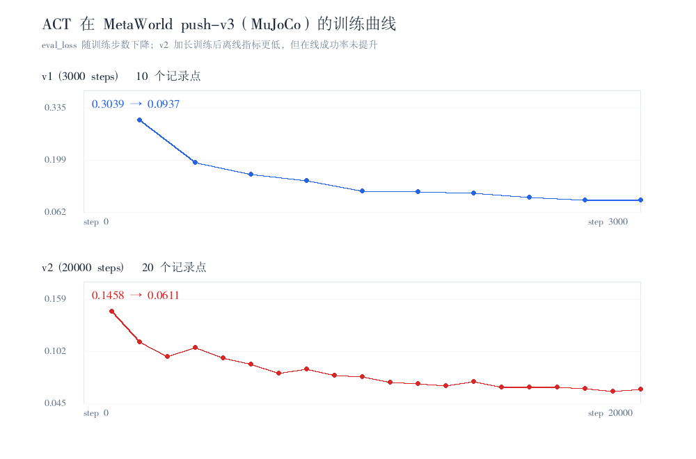

# 第二阶段验收对照报告

> 本报告由 `experiments/phase2_acceptance/scripts/build_acceptance.py` 从各实验结果 JSON 自动生成，机器可读版本见 [acceptance.json](../experiments/phase2_acceptance/results/acceptance.json)。**结论数值不手写**，与结果文件保持一致。

## 一句话判定

| 标准 | 判定 | 关键事实 |
|---|---|---|
| 1. 3 算法 × 2+ MuJoCo 环境 + 曲线/成功率 | **部分达标** | MuJoCo 环境 2 个，但只跑通 1 个算法（ACT） |
| 2. ≥5 组消融/对比 + 失败案例分析 | **通过** | 9 组消融/对比，5 类失败案例证据 |
| 3. README 四要素 + GitHub | **通过** | 环境搭建/复现/结果/demo 链接齐备，17 个视频/GIF 链接 |

## 1. 环境口径澄清（重要）

验收标准写的是「MuJoCo 环境」，本仓库三个环境的物理引擎并不相同，必须分开统计：

| 环境 | 物理引擎 | 依据 |
|---|---|---|
| PushT-v0 | **pymunk**（2D 刚体） | `gym-pusht` 包元数据 `Requires-Dist: pymunk>=6.6.0,<7.0.0`，不依赖 mujoco |
| MetaWorld push-v3 | **MuJoCo** | `metaworld 3.0.0` 要求 `mujoco>=3.0.0` |
| ALOHA AlohaInsertion-v0 | **MuJoCo** | `gym-aloha 0.1.5` 要求 `mujoco>=3.0.0,<3.9.0` |

因此**真正的 MuJoCo 环境是 2 个**（MetaWorld、ALOHA），PushT 不计入。若把 PushT 按泛化的「仿真环境」口径算进来，则覆盖 3 个环境、4 个算法；两种口径的判定差异见第 3 节，本报告不做有利于自己的口径选择。

## 2. 算法 × 环境覆盖矩阵（自动生成）

| 实验 | 算法 | 环境 | 引擎 | Episodes | 成功率 | avg_sum_reward | avg_max_reward | loss 行数 | 训练曲线 |
|---|---|---|---|---:|---:|---:|---:|---:|---|
| BC v2 (50ep) | BC | PushT-v0 | pymunk | 50 | 10.0% (5/50) | 95.24 | 0.542 | 401 | baselines/bc + train_log_v2.txt |
| ACT v3 (50k 步) | ACT | PushT-v0 | pymunk | 50 | 14.0% (7/50) | 61.67 | 0.613 | 31 | train_log.txt / assets/loss_curves.png |
| Diffusion baseline | Diffusion | PushT-v0 | pymunk | 50 | 6.0% (3/50) | 79.55 | 0.67 | 20 | train_log.txt / assets/summary_chart.png |
| Flow baseline | Flow Matching | PushT-v0 | pymunk | 50 | 2.0% (1/50) | 65.3 | 0.534 | 97 | train_log.txt（20 epoch + step 级 loss） |
| ACT MetaWorld v1 | ACT | MetaWorld push-v3 | MuJoCo | 20 | 0.0% (0/20) | 22.18 | 0.513 | 10 | assets/act_metaworld_train_curves.png (10 点) |
| ACT MetaWorld v2 | ACT | MetaWorld push-v3 | MuJoCo | 20 | 0.0% (0/20) | 19.95 | 0.477 | 20 | assets/act_metaworld_train_curves.png (20 点) |
| ACT ALOHA | ACT | ALOHA AlohaInsertion-v0 | MuJoCo | 5 | 0.0% (0/5) | 11.4 | 0.4 | 9 | assets/act_aloha_loss.png (前 900 步) |

成功率指标口径：PushT 50ep × 300 步；MetaWorld 20ep × 400 步（自研闭环脚本）；ALOHA 5ep × 400 步（`lerobot-eval`）。

**覆盖矩阵（按引擎）**

| 引擎 | 环境 | 已跑通算法 |
|---|---|---|
| pymunk | PushT-v0 | ACT, BC, Diffusion, Flow Matching（4 个） |
| MuJoCo | ALOHA AlohaInsertion-v0, MetaWorld push-v3 | ACT（1 个） |



曲线完整度说明（loss 行数由脚本解析日志自动统计，排除 tqdm 进度条）：MetaWorld v1/v2 为完整 eval_loss 序列（10 / 20 条，[train_curves.json](../experiments/act_metaworld/results/train_curves.json)）；ALOHA 仅 9 条 —— lerobot 0.7.1 只打印前 ~1000 步日志，覆盖 2000 步训练的前 45%，如实标注见 [act_aloha_transfer.md](act_aloha_transfer.md) 第 9 节。PushT 四算法的 loss 记录数见上表，均为完整序列。

## 3. 标准一：逐项判定

| 子项 | 事实 | 判定 |
|---|---|---|
| 2 个以上 MuJoCo 环境 | MetaWorld push-v3 + ALOHA = 2 个 | ✅ |
| 3 个算法在这些环境跑通 | 仅 ACT（1 个） | ❌ |
| 完整训练曲线 | PushT 四算法齐；MetaWorld 两版本齐；ALOHA 仅前 45% | ⚠️ |
| 成功率指标 | 全部 7 组实验均有 n_episodes / n_success / 奖励 | ✅ |

**结论：部分达标。** 若按严格字面（3 个算法各自在 ≥2 个 MuJoCo 环境跑通）则未达标，缺口是 BC / Diffusion / Flow 三个算法都只在 PushT（pymunk）上训练与评估，未迁移到 MuJoCo 环境。这一点不能靠文档表述弥补，补跑方案见第 6 节。

## 4. 标准二：消融 / 对比实验清单（自动生成）

共 **9 组**（要求 ≥5）：

| 编号 | 实验 | 关键结论 | 证据 |
|---|---|---|---|
| A1 | ACT chunk_size 消融 (1 / 10 / 30) | chunk=1 成功率归零，chunk=10 最优 18% | [experiments/act_ablation/RESULTS.md](../experiments/act_ablation/RESULTS.md) |
| A2 | ACT CVAE 消融 (use_vae true / false) | 关闭 CVAE 成功率 14%→6%，峰值覆盖率反升 | [experiments/act_ablation/RESULTS.md](../experiments/act_ablation/RESULTS.md) |
| A3 | Diffusion 推理采样步数消融 (DDIM5 / DDIM20 / DDPM100) | 5 步 DDIM 追平 100 步，重规划 51ms vs 1235ms | [experiments/diffusion_inference_steps/RESULTS.md](../experiments/diffusion_inference_steps/RESULTS.md) |
| A4 | 扩散 vs 流匹配 步数消融 (7 档) | Flow 1 步 2.67ms / 覆盖率 0.727；Diffusion 10–50 步 95–463ms | [experiments/flow_vs_diffusion/results/ablation_table.md](../experiments/flow_vs_diffusion/results/ablation_table.md) |
| A5 | 训练稳定性对比 (loss CV) | Flow CV 0.147 vs Diffusion 0.310 | [experiments/flow_vs_diffusion/results/stability.json](../experiments/flow_vs_diffusion/results/stability.json) |
| A6 | 动作平滑度对比 (jerk / 块边界) | jerk 0.422 vs 0.666，均无高频颤动 | [experiments/flow_vs_diffusion/results/smoothness.json](../experiments/flow_vs_diffusion/results/smoothness.json) |
| A7 | 四算法同协议基线对比 (7680 步) | Diffusion 6% > Flow 2% > ACT/BC 0% | [experiments/flow_baseline/RESULTS.md](../experiments/flow_baseline/RESULTS.md) |
| A8 | 训练量扩展对比 (BC v1→v2 / ACT v1→v2→v3) | ACT 0%→5%→8%→14%，eval_loss 几乎不变 | [experiments/act_v3/RESULTS.md](../experiments/act_v3/RESULTS.md) |
| A9 | 失效模式 50ep 配对假设检验 (H1–H6) | H1/H3 不支持、H5 强支持 | [experiments/failure_modes/results/failure_summary.json](../experiments/failure_modes/results/failure_summary.json) |

**失败案例分析**（5 类证据）：

| 内容 | 文档 | 附加证据 |
|---|---|---|
| 生成式动作头失效模式逐帧对比（3+3 轨迹、6 假设） | [docs/failure_mode_analysis.md](../docs/failure_mode_analysis.md) | `experiments/failure_modes/` |
| 三算法失效模式深度分析 | [docs/comparison.md](../docs/comparison.md) | `assets/diffusion_nearmiss.gif` |
| 11 条真实故障归因库 | [docs/findings.md](../docs/findings.md) | `assets/demo_failure.mp4` |
| ACT 消融四类失效画像 | [experiments/act_ablation/RESULTS.md](../experiments/act_ablation/RESULTS.md) | `assets/ablation_chunk1_best_effort.gif` |
| 跨环境过拟合失效（悬停不接触 / 全零对照） | [experiments/act_metaworld/RESULTS.md](../experiments/act_metaworld/RESULTS.md) | `experiments/act_aloha/results/eval_summary.md` |

## 5. 标准三：README 四要素自检

由脚本扫描 README 自动判定：

| 要素 | 自检结果 | 位置 |
|---|---|---|
| 环境搭建 | ✅ | 快速开始 + 第二阶段验收导航（含 MuJoCo 版本矩阵、EGL） |
| 复现步骤 | ✅ | 各实验 RESULTS.md / run_*.sh 统一索引 |
| 实验结果 | ✅ | 结果主表 + 跨环境覆盖矩阵 |
| demo 视频链接 | ✅ | Demo 回放章节，共 17 个 mp4/GIF |

## 6. 标准一的缺口与补跑方案

要让严格口径成立，需把至少 2 个算法补到 MetaWorld 与 ALOHA。可行路径：

1. **Diffusion（成本最低）**：lerobot 0.7.1 原生 `--policy.type=diffusion`，两个数据集均已缓存到工作区 `datasets/`；沿用 [run_train.sh](../experiments/act_aloha/scripts/run_train.sh) 的命令模板替换 policy.type 即可，评估走 `lerobot-eval`。耗时参考：ACT 在 ALOHA 上 2000 步实测约 137 s，Diffusion 因网络更大需实测，此处不预估。
2. **Flow Matching / BC（自研最小实现）**：当前 `baselines/flow`、`baselines/bc` 按 PushT 的 2 维动作 / 96×96 图像编写，迁到 ALOHA 14 维 / 480×640 需改数据管线与归一化，工作量明显更大；不建议为凑数硬迁。
3. **依赖前提（已验证）**：当前共享环境 `mujoco 3.8.1` 下 ALOHA 与 MetaWorld 均可创建环境并完成 rollout，两者可共用一套依赖，无需再切换版本。

> 补跑只证明跨环境链路可用，2000 步未收敛、成功率预期为 0，不构成策略能力评价——与 [act_aloha_transfer.md](act_aloha_transfer.md) 的口径一致。

## 7. 复现

```bash
python experiments/phase2_acceptance/scripts/build_acceptance.py
python experiments/act_metaworld/scripts/plot_train_curves.py
```

## 8. 边界与诚实性声明

1. 成功率口径不统一：PushT 50ep、MetaWorld 20ep、ALOHA 5ep，且 ALOHA Wilson 95% CI 为 0%–43.4%，样本量小，不可跨环境直接比较高低。
2. 多数跨环境成功率为 0（未收敛），本报告只用它们证明「链路跑通 + 指标齐全」，不用于算法优劣排序。
3. 环境引擎归属以包元数据为准，不把 pymunk 环境计入 MuJoCo。
