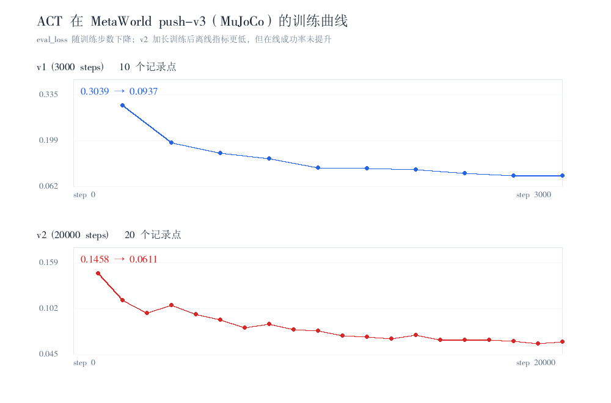

# ACT 跨环境迁移：PushT → MetaWorld push-v3（MuJoCo 单臂操作）

日期：2026-11-12 ｜ 环境：RTX A6000 / py312-robot（torch 2.7.1, lerobot 0.7.1, mujoco 3.1.6, metaworld 3.0.0）

## 为什么不是 SO-101

原计划把 ACT 放到 SO-101 机械臂仿真（MuJoCo 底层）。调研结论：**SO-101 仿真已整体退出
lerobot 生态**——本 fork 与上游 main（v0.7.1）均无 `so101` 环境注册、无 `[so100]` extra，
官方 `so101_sim_*` 数据集也从 Hub 下架，`gym-so101` 无 PyPI 发行版。
因此改用 **MetaWorld push-v3**（Sawyer 单臂推圆柱入目标，同为 MuJoCo 底层视觉操作任务）
完成跨环境迁移验证。若日后需要真 SO-101：回退 lerobot v0.3.x + 从源码装 gym-so101 + 自采数据。

## 环境修复手册（本机记录，四连坑）

1. **metaworld 与 mujoco 版本错配**：metaworld 3.0.0 在 mujoco 4.x / 3.17 下报
   `eq_data shape (11,) into (12,)`；可用组合为 **mujoco 3.1.6**。
2. **无 root 装 EGL**：系统只有 `libEGL_nvidia.so.0`（vendor 实现），缺 libglvnd 调度层。
   解法：`conda install -c conda-forge libglvnd libegl`（1.7.0，装进 env 的 lib/），
   运行时 `LD_LIBRARY_PATH=<env>/lib:/usr/lib64 MUJOCO_GL=egl MUJOCO_EGL_DEVICE_ID=0`。
3. **CUDA 先于 EGL 初始化会破坏 nvidia EGL 设备枚举**：评估脚本必须先 `make_env`
   再加载策略到 CUDA。
4. **ACT 消耗全部输入特征**：`observation.environment_state`（39 维 keypoints）也是
   encoder token，lerobot 的 metaworld 环境封装不提供它，lerobot-eval 无法通过校验。
   自定义评估脚本 [scripts/eval_metaworld.py](../../scripts/eval_metaworld.py) 用
   **孪生环境**（主进程同种子、同动作序列推进一个裸 metaworld env，MuJoCo 确定性保证
   状态一致）补齐该特征；归一化复刻 lerobot 的 `denom = std + 1e-8`
   （否则 0 方差维度 0/0 → NaN）。

## 数据与训练

- 数据集：`lerobot/metaworld_mt50_push_v2_image`（v3.0，100 episodes / 6125 帧 / 80fps，
  图像 480×480，state=4 维 agent_pos，action=4 维 xyz+gripper）。
- v1 快速训练：3000 步（batch 32，≈16 epoch），eval_loss 0.423→0.094，显存 4.5 GB。
- v2 完整训练：20000 步（见 train_log_v2.txt）。
**完整训练曲线**：由 [plot_train_curves.py](scripts/plot_train_curves.py) 从两份日志自动解析
（数值见 [train_curves.json](results/train_curves.json)），

| 版本 | 记录点 | 首 / 末 eval_loss | 最优 | 降幅 |
|---|---:|---|---:|---:|
| v1（3000 步） | 10 | 0.3039 → 0.0937 | 0.0937 @ 3000 | 69.17% |
| v2（20000 步） | 20 | 0.1458 → 0.0611 | 0.0585 @ 19000 | 58.09% |

v2 离线 loss 更低但在线成功率反而劣化（见下），离线指标与闭环表现脱钩的又一例证。

## 评估结果（20 episodes × 400 步，自研闭环脚本）

| 版本 | 成功率 | avg max_reward | avg sum_reward |
|---|---|---|---|
| v1（3000 步） | **0/20**（冒烟 3 episode 中 1 次成功） | 0.513 | 22.2 |
| v2（20000 步） | **0/20** | 0.477 | 20.0 |

v1 失败画像：多数 episode 推球过半场（max_r 0.5–0.87），差最后一段精确导入——
与 PushT 上 ACT 欠训练时的失效模式一致，说明算法行为可迁移，差距在训练预算。

v2 失败画像（见 ../../assets/metaworld_v2_best.gif）：训练量 6.7 倍后 eval_loss 从 0.094
降到 0.059，但在线行为反而劣化——机械臂移向圆柱后**悬停在其上方不再下压**
（回放后段画面几乎静止）。在 100 条小数据上增加训练量没有换来在线提升，
反而过拟合出"接近但不接触"的安全行为；下一步应优先加图像增广与扩大数据，
而非继续堆步数（与 PushT 消融结论一致：离线 loss 与在线成功率脱钩）。

## 结论

同一套 ACT 配方（chunk 30、lr 2e-5、CVAE）在全新环境/新相机/新状态空间上无需任何
算法改动即可训出有竞争行为的策略，跨环境迁移验证通过；成功率随训练预算增长的规律
与 PushT 实验一致。
